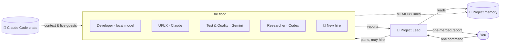

<div align="center">


# Atrium

### Your AI agent office. Every project is a floor, every agent has a room.

Give one command to a project lead — watch a team of AI agents walk to their desks, work,
and come back with a single clear report. Claude, Codex, Gemini or **free local models** on your own computer —
all your projects, all your Claude Code chats, one building.

[](https://github.com/RealMrNovember/Atrium/releases/latest)
[](https://github.com/RealMrNovember/Atrium/releases)
[](https://github.com/RealMrNovember/Atrium/releases/latest)
[](#-works-with-your-ai)
[](#-six-languages)
[](LICENSE)
[](https://github.com/RealMrNovember/Atrium/stargazers)
[](https://buymeacoffee.com/mikeross)

**English** · [Türkçe](docs/readme/README.tr.md) · [Deutsch](docs/readme/README.de.md) · [Français](docs/readme/README.fr.md) · [Italiano](docs/readme/README.it.md) · [Русский](docs/readme/README.ru.md)

[**⬇ Download**](https://github.com/RealMrNovember/Atrium/releases/latest) · [**🌐 Showroom**](https://atrium.cicibyte.com) · [**📜 What's new**](https://github.com/RealMrNovember/Atrium/releases) · [**⭐ Star**](https://github.com/RealMrNovember/Atrium)

<br />


</div>

---

## Why Atrium?

If you use AI coding agents across many projects, you know the pain: every new session starts from zero,
you repeat the same context, you lose track of which project is doing what, and the bill grows
with every "let me read the whole repo again".

Atrium turns that into a company you can **see**:

- 🏢 **Your projects become a building.** Point Atrium at your projects folder; every subfolder becomes a floor.
- 👥 **Every floor has a team.** A project lead, a developer, a UI/UX designer, QA, a researcher and a memory keeper — each in their own room, at their own desk.
- 🧭 **You give one command, the lead runs the team.** The lead splits the work, agents walk in to get their tasks, work at their desks and walk back to report. You get **one** merged report.
- 🧠 **Projects remember.** Each floor keeps a short project memory that every agent reads first — so nobody re-reads the whole codebase.
- 🤝 **Not just Claude.** Each agent can run on Claude Code, OpenAI Codex CLI, Gemini CLI, Ollama or any OpenAI-compatible server — mixed on the same floor.
- 🦙 **Local AI, built in.** Atrium measures your computer, shows which open models will run, downloads and installs Ollama and the models for you, and lets any agent use them — free, offline and private.
- 💬 **Your Claude Code chats move in.** Atrium reads your existing Claude Code conversations and files them by project. Open chats light up their floor, and when a chat waits for your decision an agent leans out of the window and calls you.
- 🛡️ **You stay in charge.** Read-only by default, secrets are off-limits, spending caps everywhere, and nothing is ever published or pushed. The final call is yours.

## 🤖 Works with your AI

Pick the AI per agent — your lead can be Claude while the developer runs a local coder model and the researcher uses Gemini.

| AI tool | What you need | Best for |
|---|---|---|
| ✳️ **Claude Code** | [Claude Code](https://docs.anthropic.com/en/docs/claude-code) signed in, or an Anthropic API key | The strongest agents; plan-usage meter and dollar caps |
| 🌀 **OpenAI Codex CLI** | `npm i -g @openai/codex`, then **Sign in** in Atrium | Agents on your ChatGPT plan |
| ♊ **Gemini CLI** | `npm i -g @google/gemini-cli`, Google sign-in or a Gemini API key | Agents on your Google account |
| 🦙 **Ollama** | Nothing — Atrium installs it from the **Local AI** page | Free, offline, private work |
| 🔌 **OpenAI compatible** | An address (LM Studio, llama.cpp, vLLM, OpenRouter, OpenAI API) | Models you already host |

<table><tr>
<td width="50%"></td>
<td width="50%"></td>
</tr><tr>
<td align="center"><b>One team, many AIs</b> — every agent shows its tool and model.</td>
<td align="center"><b>Switch in two clicks</b> — AI tool and model per agent.</td>
</tr></table>

## 🦙 Local AI

Run agents on open models that live on your own computer — no account, no subscription, no data leaving the machine.

1. **Measure.** Atrium reads your processor, memory, graphics card and free disk, and tells you which model sizes run well.
2. **Install the engine.** One click downloads the official Ollama release and installs it — no terminal needed.
3. **Download a model.** A catalog of 37 open models (general, coding, reasoning, vision, embeddings and more), each marked 🟢 *runs fast*, 🟡 *runs slowly* or 🔴 *too big* for **your** machine, with a ⭐ recommendation.
4. **Try it and hire it.** Chat with the model right on the page, then give it to any agent.

Models marked **Can be an agent** open and read project files through Atrium's own safe tools: they stay inside the project folder, never open secret files and never run shell commands.

<table><tr>
<td width="50%"></td>
<td width="50%"></td>
</tr><tr>
<td align="center"><b>Your computer, measured</b> — engine status and your models.</td>
<td align="center"><b>A catalog that knows your hardware</b> — one-click download.</td>
</tr></table>

## 🪙 How Atrium saves tokens

Atrium is designed around one idea: **don't pay twice for the same context.**

| Mechanism | What it does |
|---|---|
| **Project memory** | A compact Markdown summary per project (what it is, stack, structure, how to run, decisions, recent work, lessons). Every agent reads it *first* and is told to open only the files it needs instead of scanning the repo. |
| **Self-updating memory** | After each job, the lead's summary goes into *Recent work* and agents' `MEMORY:` lines go into *Learned*. The next job starts smarter — without re-discovering the same facts. |
| **Focus folders** | Each agent knows which folders it works in and starts there. |
| **Chats become context** | When memory is extracted, the titles and opening requests of your past Claude Code chats for that project are included — your goals and decisions carry over without pasting them again. |
| **Right model for the job** | Haiku for the memory keeper, Sonnet or Opus where it matters — or a free local model for routine work. |
| **Cheap planning, cheap merging** | The lead plans with read-only tools and a small budget, and merges reports with **no tools at all**. |
| **Hard caps** | Per-run budget, per-run time limit and a company-wide daily cap. If a run times out and its cost can't be read, the **full cap is counted** — the daily cap is never under-counted. |
| **Simulation mode** | Explore the whole app, animations and flows without spending a cent. |

## How it works



1. **Command.** Open a floor and tell the lead what you want. Allow file changes only if you want edits. Or click **Status round** and the lead walks desk to desk collecting reports.
2. **Plan.** The lead reads the project memory, splits the work into up to four tasks and — if no one fits — **hires a specialist** who walks out of the elevator into an empty room.
3. **Work.** Agents walk to the lead's office to get their task, go back to their desk and work. Their screens light up and a speech bubble shows what they are doing right now (`📄 reading cart.ts`, `🔎 searching "calculateTotal"`).
4. **Report.** Each agent walks back with a report; the lead merges everything into *Summary · Done · Findings & risks · Waiting for your decision · Next steps*.
5. **Remember.** Lessons go into the project memory for next time.

## 📸 More screenshots

| | |
|---|---|
|  **The building** — every project is a floor; bright windows mean work, warm ones an open chat. |  **Project memory** — the summary every agent reads first. |
|  **Your Claude Code chats** — filed by project, continue them right in Atrium. |  **One report** — the lead merges the team's work. |
|  **First-run setup** — six languages. |  **Connect Claude** — Atrium checks Claude Code and sign-in for you. |

## ✨ Also inside

- 📊 **Plan usage meter** — your Claude session and weekly limits, live in the top bar.
- 🔔 **A floor that calls you** — when a Claude Code chat waits for your decision, an agent waves from that floor's window.
- 🎁 **What's new** — release notes in your language, shown before an update even downloads; full version history in Settings.
- 🔄 **Automatic updates** — Atrium checks at launch and every few minutes, downloads in the background and installs on restart.
- 🔊 **Sound effects** and an **in-app guide** in six languages.

## ⬇ Install

Download the installer for your system from the [**latest release**](https://github.com/RealMrNovember/Atrium/releases/latest):

| System | File |
|---|---|
| Windows 10/11 | `Atrium-Setup-x.y.z.exe` |
| macOS | `Atrium-x.y.z-arm64.dmg` / `-x64.dmg` |
| Linux | `Atrium-x.y.z-x86_64.AppImage` or `.deb` |

> macOS builds are not notarized yet: right-click the app → **Open** the first time.

### Requirements

At least **one** AI tool — any of these is enough:

- [Claude Code](https://docs.anthropic.com/en/docs/claude-code) (`npm install -g @anthropic-ai/claude-code`) signed in, or an Anthropic API key (stored encrypted with your OS keychain);
- [OpenAI Codex CLI](https://github.com/openai/codex) or [Gemini CLI](https://github.com/google-gemini/gemini-cli);
- an OpenAI-compatible server;
- or **no cloud AI at all** — install Ollama and local models from the **Local AI** page.

Just curious? Turn on **Simulation** and explore everything for free.

### First run

The setup wizard walks you through six steps: **language → company (name, slogan, logo) → projects folder → Claude connection → your Claude Code chats → spending limits.** Then your building rises. Other AI tools are connected under **Profile & Settings → AI tools**.

### Build from source

```bash
git clone https://github.com/RealMrNovember/Atrium.git
cd Atrium
npm install
npm run dev        # run with hot reload
npm run dist       # build an installer for your OS into dist/
```

## 🌍 Six languages

English · Türkçe · Deutsch · Français · Italiano · Русский — the interface, the in-app guide, release notes **and** the agents' reports and memory follow the language you pick. Atrium suggests your system language on first run.

## 🛡️ Safety

- Agents **cannot read** `.env`, private keys (`*.pem`, `*.key`, `id_rsa*`, `id_ed25519*`) or other secret files.
- Claude agents and local models **cannot run shell commands**; Codex and Gemini run inside their own sandbox and receive the same rules.
- **Read-only by default.** File changes are allowed per command.
- Agents never commit, push, install packages, message anyone or publish anything.
- Text from web pages and files is treated as data, never as instructions.
- Your code, chats and memory stay on your computer.

See [SECURITY.md](SECURITY.md) to report a vulnerability.

## ❓ FAQ

<details><summary><b>Does Atrium send my code or chats anywhere?</b></summary>

No. Your code, chats and project memory stay on your computer. Agents run through the AI tool you choose (Claude Code, Codex, Gemini — or a local model, where nothing leaves the machine). Atrium itself only checks GitHub and atrium.cicibyte.com for updates and release notes.
</details>

<details><summary><b>Can I use Atrium without Claude?</b></summary>

Yes. Any agent can run on OpenAI Codex CLI, Gemini CLI, an OpenAI-compatible server or a local model through Ollama. Atrium can install Ollama and the models for you.
</details>

<details><summary><b>Do I need a powerful computer for local AI?</b></summary>

No. Small models (1–4B) run on almost any recent computer, even without a graphics card. The **Local AI** page measures your machine and shows exactly which models run fast, slowly or not at all — and recommends one.
</details>

<details><summary><b>How much does it cost?</b></summary>

Atrium is free. Agent runs use your own Claude, ChatGPT or Google plan or API key — or cost nothing with local models. For Claude, Atrium enforces a per-run and a daily cap that you choose.
</details>

<details><summary><b>Which projects become floors?</b></summary>

Every subfolder of the folder you choose, except hidden folders and folders starting with `_`. You can exclude projects, add projects from other folders and reorder the floors.
</details>

<details><summary><b>Can I change the team?</b></summary>

Yes — rename agents, edit their job descriptions, pick their AI tool and model, give them web access, move them between rooms, or click an empty room to hire. The lead can also hire specialists on its own when a job needs one.
</details>

## 🤝 Contributing

Bug reports, ideas, translations and pull requests are very welcome — see [CONTRIBUTING.md](CONTRIBUTING.md).
Atrium is source-available: you may fork to send contributions back; please don't publish modified copies.

## 💜 Support

If Atrium saves you time:

- ⭐ **Star this repository** — it really helps.
- 📣 **Share it** with a friend or your team.
- 🐛 **Report bugs** and suggest features in [Issues](https://github.com/RealMrNovember/Atrium/issues).
- ☕ **Buy me a coffee** — [buymeacoffee.com/mikeross](https://buymeacoffee.com/mikeross).

## License

Free to use, including commercially. Copying, modifying or redistributing requires written permission.
See the [Atrium License](LICENSE).

<div align="center">
<br />
<a href="https://cicibyte.com"><b>CiciByte Technology, Inc.</b></a> · <a href="https://atrium.cicibyte.com">atrium.cicibyte.com</a>
</div>
