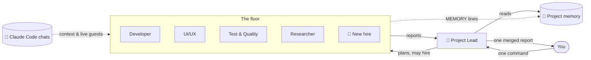

<div align="center">


# Atrium

### Your AI agent office. Every project is a floor, every agent has a room.

Give one command to a project lead — watch a team of Claude agents walk to their desks, work,
and come back with a single clear report. All your projects, all your Claude Code chats, one building.

[](https://github.com/RealMrNovember/Atrium/releases/latest)
[](https://github.com/RealMrNovember/Atrium/releases/latest)
[](#-six-languages)
[](LICENSE)
[](https://github.com/RealMrNovember/Atrium/stargazers)

**English** · [Türkçe](docs/readme/README.tr.md) · [Deutsch](docs/readme/README.de.md) · [Français](docs/readme/README.fr.md) · [Italiano](docs/readme/README.it.md) · [Русский](docs/readme/README.ru.md)

[**⬇ Download**](https://github.com/RealMrNovember/Atrium/releases/latest) · [**🌐 Showroom**](https://atrium.cicibyte.com) · [**⭐ Star**](https://github.com/RealMrNovember/Atrium)

<br />


</div>

---

## Why Atrium?

If you use Claude Code across many projects, you know the pain: every new session starts from zero,
you repeat the same context, you lose track of which project is doing what, and the bill grows
with every "let me read the whole repo again".

Atrium turns that into a company you can **see**:

- 🏢 **Your projects become a building.** Point Atrium at your projects folder; every subfolder becomes a floor.
- 👥 **Every floor has a team.** A project lead, a developer, a UI/UX designer, QA, a researcher and a memory keeper — each in their own room, at their own desk.
- 🧭 **You give one command, the lead runs the team.** The lead splits the work, agents walk in to get their tasks, work at their desks and walk back to report. You get **one** merged report.
- 🧠 **Projects remember.** Each floor keeps a short project memory that every agent reads first — so nobody re-reads the whole codebase.
- 💬 **Your Claude Code chats move in.** Atrium reads your existing Claude Code conversations and files them by project. Sub-agents Claude spins up in those chats show up **live** as guests in an empty room.
- 🛡️ **You stay in charge.** Read-only by default, secrets are off-limits, spending caps everywhere, and nothing is ever published or pushed. The final call is yours.

## 🪙 How Atrium saves tokens

Atrium is designed around one idea: **don't pay twice for the same context.**

| Mechanism | What it does |
|---|---|
| **Project memory** | A compact Markdown summary per project (what it is, stack, structure, how to run, decisions, recent work, lessons). Every agent reads it *first* and is told to open only the files it needs instead of scanning the repo. |
| **Self-updating memory** | After each job, the lead's summary goes into *Recent work* and agents' `MEMORY:` lines go into *Learned*. The next job starts smarter — without re-discovering the same facts. |
| **Chats become context** | When memory is extracted, the titles and opening requests of your past Claude Code chats for that project are included — your goals and decisions carry over without pasting them again. |
| **Right model for the job** | The memory keeper runs on Haiku by default; you choose Haiku / Sonnet / Opus per agent. |
| **Cheap planning, cheap merging** | The lead plans with read-only tools and a small budget, and merges reports with **no tools at all**. |
| **Focused tasks** | Each agent receives one self-contained task, not the whole conversation. |
| **Hard caps** | Per-run budget, per-run time limit and a company-wide daily cap. If a run times out and its cost can't be read, the **full cap is counted** — the daily cap is never under-counted. |
| **Simulation mode** | Explore the whole app, animations and flows without spending a cent. |

## How it works



1. **Command.** Open a floor and tell the lead what you want. Allow file changes only if you want edits.
2. **Plan.** The lead reads the project memory, splits the work into up to four tasks and — if no one fits — **hires a specialist** who walks out of the elevator into an empty room.
3. **Work.** Agents walk to the lead's office to get their task, go back to their desk and work. Their screens light up and a speech bubble shows what they are doing right now (`📄 reading cart.ts`, `🔎 searching "calculateTotal"`).
4. **Report.** Each agent walks back with a report; the lead merges everything into *Summary · Done · Findings & risks · Waiting for your decision · Next steps*.
5. **Remember.** Lessons go into the project memory for next time.

## 📸 Screenshots

| | |
|---|---|
|  **The building** — every project is a floor; lit windows mean agents are at work. |  **Project memory** — the summary every agent reads first. |
|  **Your Claude Code chats** — filed by project, with sub-agent counts. |  **One report** — the lead merges the team's work. |
|  **First-run setup** — six languages. |  **Connect Claude** — Atrium checks Claude Code and sign-in for you. |

## ⬇ Install

Download the installer for your system from the [**latest release**](https://github.com/RealMrNovember/Atrium/releases/latest):

| System | File |
|---|---|
| Windows 10/11 | `Atrium-Setup-x.y.z.exe` |
| macOS | `Atrium-x.y.z-arm64.dmg` / `-x64.dmg` |
| Linux | `Atrium-x.y.z-x64.AppImage` or `.deb` |

> macOS builds are not notarized yet: right-click the app → **Open** the first time.

### Requirements

- [Claude Code](https://docs.anthropic.com/en/docs/claude-code) installed (`npm install -g @anthropic-ai/claude-code`) and signed in — or an Anthropic API key, which Atrium stores encrypted with your OS keychain.
- No Claude yet? Turn on **Simulation** and explore everything for free.

### First run

The setup wizard walks you through six steps: **language → company (name, slogan, logo) → projects folder → Claude connection → your Claude Code chats → spending limits.** Then your building rises.

### Build from source

```bash
git clone https://github.com/RealMrNovember/Atrium.git
cd Atrium
npm install
npm run dev        # run with hot reload
npm run dist       # build an installer for your OS into dist/
```

## 🌍 Six languages

English · Türkçe · Deutsch · Français · Italiano · Русский — the interface **and** the agents' reports and memory follow the language you pick. Atrium suggests your system language on first run.

## 🛡️ Safety

- Agents **cannot read** `.env`, private keys (`*.pem`, `*.key`, `id_rsa*`, `id_ed25519*`) and **cannot run shell commands**.
- **Read-only by default.** File changes are allowed per command; then agents work one at a time.
- Agents never commit, push, install packages, message anyone or publish anything.
- Text from web pages and files is treated as data, never as instructions.
- Everything stays on your computer: chats are read locally, data lives in your user folder.

See [SECURITY.md](SECURITY.md) to report a vulnerability.

## ❓ FAQ

<details><summary><b>Does Atrium send my code or chats anywhere?</b></summary>

No. Atrium itself has no server. Agents run through Claude Code on your machine, exactly like when you use Claude Code directly.
</details>

<details><summary><b>How much does it cost?</b></summary>

Atrium is free. Agent runs use your Claude Code plan or your API key; Atrium enforces a per-run and a daily cap that you choose.
</details>

<details><summary><b>Which projects become floors?</b></summary>

Every subfolder of the folder you choose, except hidden folders and folders starting with `_`.
</details>

<details><summary><b>Can I change the team?</b></summary>

Yes — rename agents, edit their job descriptions, pick their model, give them web access, move them between rooms, or click an empty room to hire. The lead can also hire specialists on its own when a job needs one.
</details>

## 🤝 Contributing

Bug reports, ideas, translations and pull requests are very welcome — see [CONTRIBUTING.md](CONTRIBUTING.md).
Atrium is source-available: you may fork to send contributions back; please don't publish modified copies.

## 💜 Support

Atrium is free and will stay free. If it saves you time:

- ⭐ **Star this repository** — it really helps.
- 📣 **Share it** with a friend or your team.
- 🐛 **Report bugs** and suggest features in [Issues](https://github.com/RealMrNovember/Atrium/issues).
- ☕ **Sponsor** — donation links are on the [showroom](https://atrium.cicibyte.com/#support).

## License

Free to use, including commercially. Copying, modifying or redistributing requires written permission.
See the [Atrium License](LICENSE).

<div align="center">
<br />
<a href="https://cicibyte.com"><b>CiciByte Technology, Inc.</b></a> · <a href="https://atrium.cicibyte.com">atrium.cicibyte.com</a>
</div>
