<div align="center">

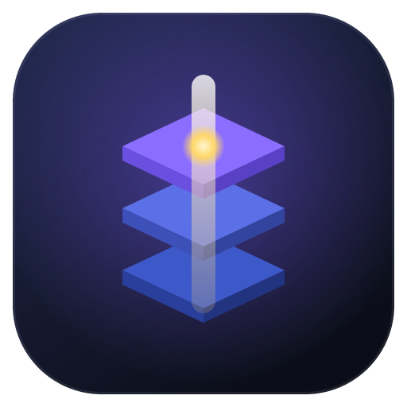

# Atrium

### Dein KI-Agenten-Büro. Jedes Projekt ist eine Etage, jeder Agent hat ein eigenes Zimmer.

Gib dem Projektleiter einen einzigen Befehl — und sieh zu, wie ein Team aus KI-Agenten zu seinen Schreibtischen geht, arbeitet
und mit einem einzigen klaren Bericht zurückkommt. Claude, Codex, Gemini oder **kostenlose lokale Modelle** auf deinem eigenen Computer —
alle deine Projekte, alle deine Claude-Code-Chats, ein Gebäude.

[](https://github.com/RealMrNovember/Atrium/releases/latest)
[](https://github.com/RealMrNovember/Atrium/releases)
[](https://github.com/RealMrNovember/Atrium/releases/latest)
[](#-funktioniert-mit-deiner-ki)
[](#-sechs-sprachen)
[](../../LICENSE)
[](https://github.com/RealMrNovember/Atrium/stargazers)
[](https://buymeacoffee.com/mikeross)

[English](../../README.md) · [Türkçe](README.tr.md) · **Deutsch** · [Français](README.fr.md) · [Italiano](README.it.md) · [Русский](README.ru.md)

[**⬇ Herunterladen**](https://github.com/RealMrNovember/Atrium/releases/latest) · [**🌐 Showroom**](https://atrium.cicibyte.com) · [**📜 Neuigkeiten**](https://github.com/RealMrNovember/Atrium/releases) · [**⭐ Star geben**](https://github.com/RealMrNovember/Atrium)

<br />

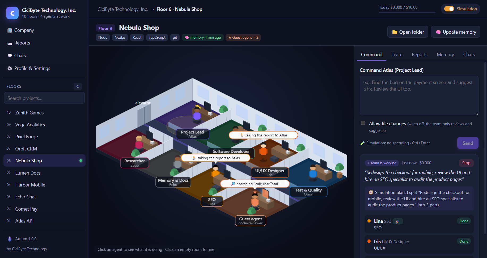

</div>

---

## Warum Atrium?

Wenn du KI-Coding-Agenten in vielen Projekten nutzt, kennst du das Problem: Jede neue Sitzung beginnt bei null,
du wiederholst denselben Kontext, verlierst den Überblick, welches Projekt gerade was macht, und die Rechnung wächst
mit jedem „ich lese mal eben das ganze Repo noch einmal".

Atrium macht daraus ein Unternehmen, das du **sehen** kannst:

- 🏢 **Deine Projekte werden zu einem Gebäude.** Richte Atrium auf deinen Projektordner; jeder Unterordner wird zu einer Etage.
- 👥 **Jede Etage hat ein Team.** Einen Projektleiter, einen Entwickler, einen UI/UX-Designer, QA, einen Rechercheur und einen Gedächtnis-Hüter — jeder in seinem eigenen Zimmer, an seinem eigenen Schreibtisch.
- 🧭 **Du gibst einen Befehl, der Leiter führt das Team.** Der Leiter teilt die Arbeit auf, die Agenten kommen vorbei, um ihre Aufgaben abzuholen, arbeiten an ihren Schreibtischen und gehen zurück, um zu berichten. Du bekommst **einen** zusammengeführten Bericht.
- 🧠 **Projekte erinnern sich.** Jede Etage führt ein kurzes Projektgedächtnis, das jeder Agent zuerst liest — so liest niemand die ganze Codebasis erneut.
- 🤝 **Nicht nur Claude.** Jeder Agent kann mit Claude Code, OpenAI Codex CLI, Gemini CLI, Ollama oder einem OpenAI-kompatiblen Server laufen — gemischt auf derselben Etage.
- 🦙 **Lokale KI, eingebaut.** Atrium misst deinen Computer, zeigt, welche offenen Modelle laufen, lädt Ollama und die Modelle für dich herunter und installiert sie — und jeder Agent kann sie nutzen: kostenlos, offline und privat.
- 💬 **Deine Claude-Code-Chats ziehen ein.** Atrium liest deine bestehenden Claude-Code-Unterhaltungen und sortiert sie nach Projekt. Offene Chats bringen ihre Etage zum Leuchten, und wenn ein Chat auf deine Entscheidung wartet, lehnt sich ein Agent aus dem Fenster und ruft dich.
- 🛡️ **Du behältst die Kontrolle.** Standardmäßig schreibgeschützt, Geheimnisse sind tabu, überall gibt es Ausgabenlimits, und nichts wird je veröffentlicht oder gepusht. Das letzte Wort hast du.

## 🤖 Funktioniert mit deiner KI

Wähle die KI pro Agent — dein Leiter kann Claude sein, während der Entwickler ein lokales Coding-Modell nutzt und der Rechercheur Gemini.

| KI-Tool | Was du brauchst | Ideal für |
|---|---|---|
| ✳️ **Claude Code** | Angemeldetes [Claude Code](https://docs.anthropic.com/en/docs/claude-code) oder ein Anthropic-API-Schlüssel | Die stärksten Agenten; Tarif-Nutzungsanzeige und Dollar-Limits |
| 🌀 **OpenAI Codex CLI** | `npm i -g @openai/codex`, dann **Anmelden** in Atrium | Agenten mit deinem ChatGPT-Tarif |
| ♊ **Gemini CLI** | `npm i -g @google/gemini-cli`, Google-Anmeldung oder ein Gemini-API-Schlüssel | Agenten mit deinem Google-Konto |
| 🦙 **Ollama** | Nichts — Atrium installiert es auf der Seite **Lokale KI** | Kostenloses, offline und privates Arbeiten |
| 🔌 **OpenAI-kompatibel** | Eine Adresse (LM Studio, llama.cpp, vLLM, OpenRouter, OpenAI API) | Modelle, die du bereits selbst hostest |

<table><tr>
<td width="50%">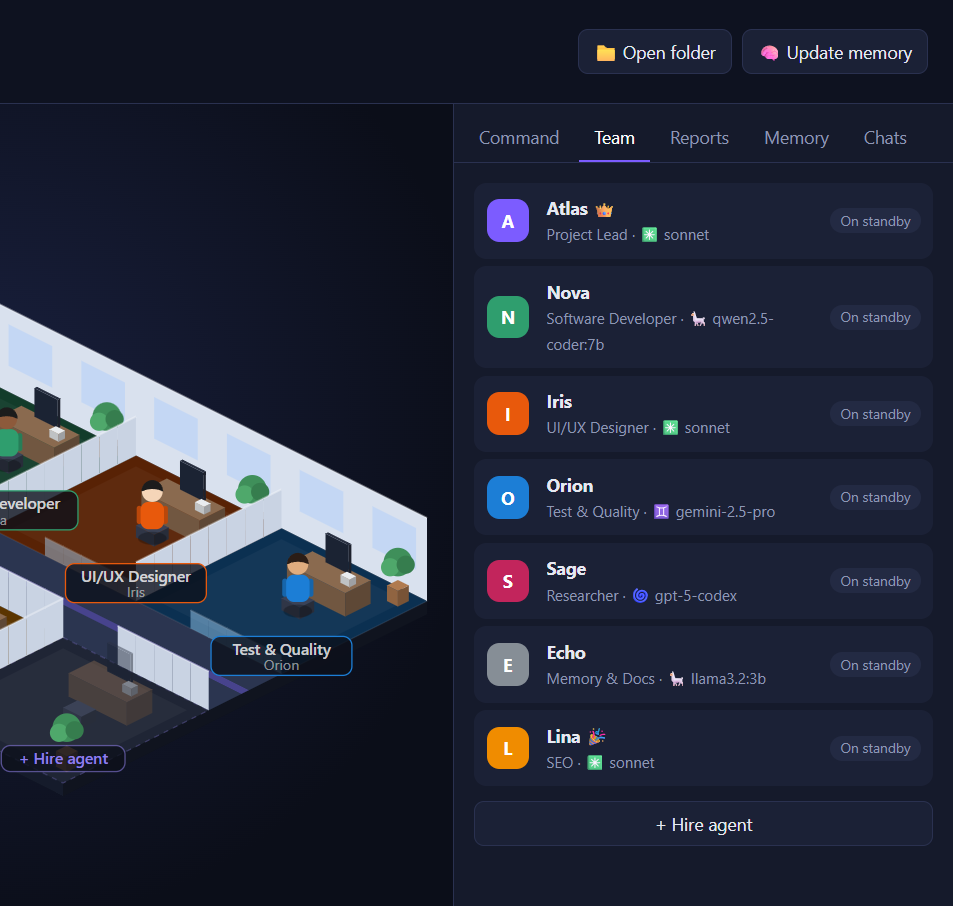</td>
<td width="50%">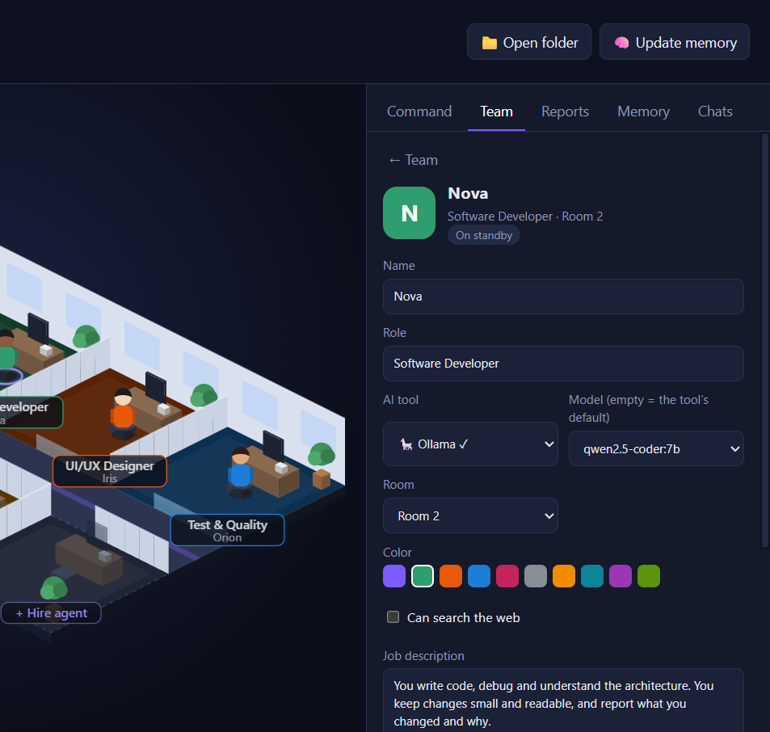</td>
</tr><tr>
<td align="center"><b>Ein Team, viele KIs</b> — jeder Agent zeigt sein Tool und sein Modell.</td>
<td align="center"><b>Wechsel mit zwei Klicks</b> — KI-Tool und Modell pro Agent.</td>
</tr></table>

## 🦙 Lokale KI

Lass Agenten mit offenen Modellen laufen, die auf deinem eigenen Computer wohnen — kein Konto, kein Abo, keine Daten verlassen den Rechner.

1. **Messen.** Atrium liest Prozessor, Arbeitsspeicher, Grafikkarte und freien Speicherplatz aus und sagt dir, welche Modellgrößen gut laufen.
2. **Engine installieren.** Ein Klick lädt die offizielle Ollama-Version herunter und installiert sie — kein Terminal nötig.
3. **Ein Modell herunterladen.** Ein Katalog mit 37 offenen Modellen (allgemein, Coding, Reasoning, Vision, Embeddings und mehr), jedes für **deinen** Rechner markiert als 🟢 *Läuft schnell*, 🟡 *Läuft langsam* oder 🔴 *Zu groß*, mit einer ⭐ Empfehlung.
4. **Ausprobieren und einstellen.** Chatte direkt auf der Seite mit dem Modell und gib es dann einem beliebigen Agenten.

Modelle mit der Markierung **Kann Agent sein** öffnen und lesen Projektdateien über Atriums eigene sichere Werkzeuge: Sie bleiben im Projektordner, öffnen nie geheime Dateien und führen nie Shell-Befehle aus.

<table><tr>
<td width="50%">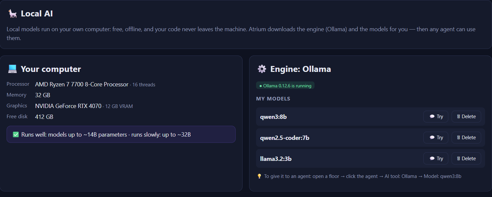</td>
<td width="50%">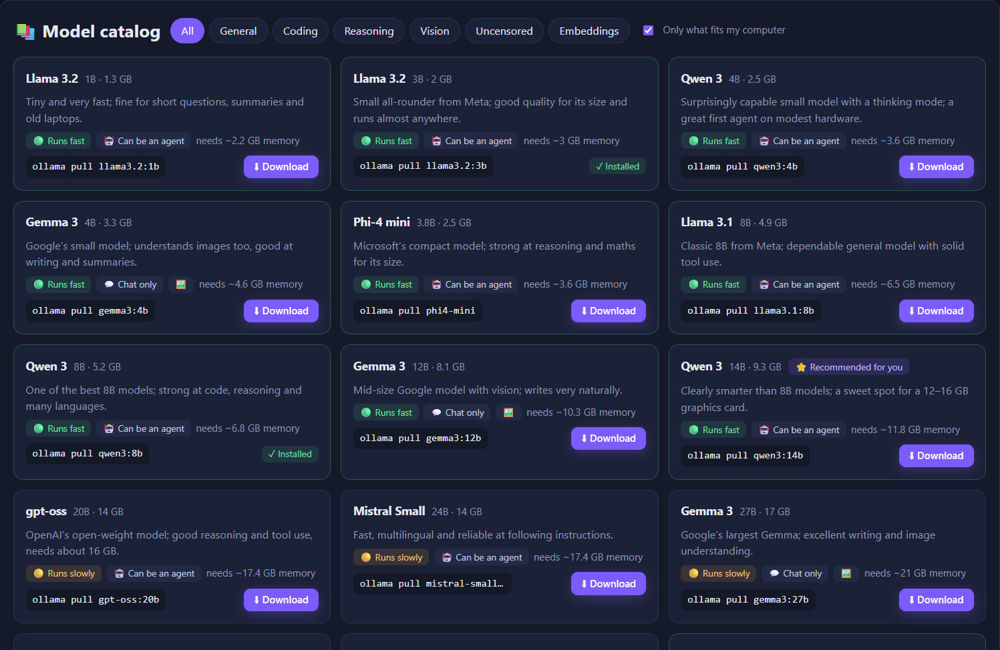</td>
</tr><tr>
<td align="center"><b>Dein Computer, vermessen</b> — Engine-Status und deine Modelle.</td>
<td align="center"><b>Ein Katalog, der deine Hardware kennt</b> — Download mit einem Klick.</td>
</tr></table>

## 🪙 So spart Atrium Tokens

Atrium folgt einer einzigen Idee: **Bezahle nicht zweimal für denselben Kontext.**

| Mechanismus | Was er bewirkt |
|---|---|
| **Projektgedächtnis** | Eine kompakte Markdown-Zusammenfassung pro Projekt (was es ist, Stack, Struktur, wie man es startet, Entscheidungen, letzte Arbeiten, Erkenntnisse). Jeder Agent liest sie *zuerst* und soll nur die Dateien öffnen, die er braucht, statt das Repo zu durchsuchen. |
| **Selbstaktualisierendes Gedächtnis** | Nach jedem Auftrag landet die Zusammenfassung des Leiters unter *Letzte Arbeiten* und die `MEMORY:`-Zeilen der Agenten unter *Gelernt*. Der nächste Auftrag startet klüger — ohne dieselben Fakten neu zu entdecken. |
| **Fokus-Ordner** | Jeder Agent weiß, in welchen Ordnern er arbeitet, und fängt dort an. |
| **Chats werden zu Kontext** | Beim Extrahieren des Gedächtnisses werden die Titel und Eingangsanfragen deiner früheren Claude-Code-Chats zu diesem Projekt einbezogen — deine Ziele und Entscheidungen bleiben erhalten, ohne dass du sie erneut einfügen musst. |
| **Das richtige Modell für die Aufgabe** | Haiku für den Gedächtnis-Hüter, Sonnet oder Opus, wo es darauf ankommt — oder ein kostenloses lokales Modell für Routinearbeit. |
| **Günstig planen, günstig zusammenführen** | Der Leiter plant mit schreibgeschützten Werkzeugen und kleinem Budget und führt Berichte **ganz ohne Werkzeuge** zusammen. |
| **Harte Limits** | Budget pro Lauf, Zeitlimit pro Lauf und ein unternehmensweites Tageslimit. Wenn ein Lauf in ein Timeout läuft und seine Kosten nicht ausgelesen werden können, wird das **volle Limit angerechnet** — das Tageslimit wird nie zu niedrig gezählt. |
| **Simulationsmodus** | Erkunde die ganze App, Animationen und Abläufe, ohne einen Cent auszugeben. |

## So funktioniert's

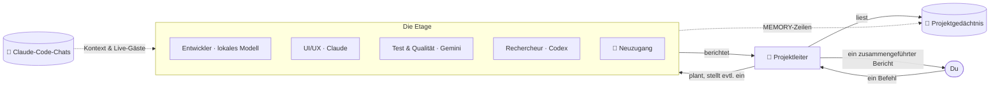

1. **Befehl.** Öffne eine Etage und sag dem Leiter, was du willst. Erlaube Dateiänderungen nur, wenn du Änderungen willst. Oder klicke auf **Statusrunde**, und der Leiter geht von Schreibtisch zu Schreibtisch und sammelt Berichte ein.
2. **Plan.** Der Leiter liest das Projektgedächtnis, teilt die Arbeit in bis zu vier Aufgaben auf und — wenn niemand passt — **stellt einen Spezialisten ein**, der aus dem Aufzug in ein leeres Zimmer geht.
3. **Arbeit.** Die Agenten gehen ins Büro des Leiters, um ihre Aufgabe abzuholen, kehren an ihren Schreibtisch zurück und arbeiten. Ihre Bildschirme leuchten auf, und eine Sprechblase zeigt, was sie gerade tun (`📄 reading cart.ts`, `🔎 searching "calculateTotal"`).
4. **Bericht.** Jeder Agent geht mit einem Bericht zurück; der Leiter führt alles zusammen zu *Zusammenfassung · Erledigt · Erkenntnisse & Risiken · Wartet auf deine Entscheidung · Nächste Schritte*.
5. **Erinnern.** Erkenntnisse wandern für das nächste Mal ins Projektgedächtnis.

## 📸 Weitere Screenshots

| | |
|---|---|
| 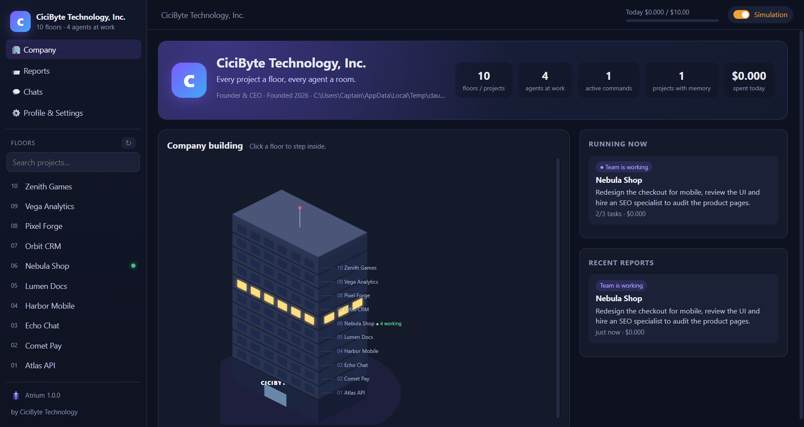 **Das Gebäude** — jedes Projekt ist eine Etage; helle Fenster bedeuten Arbeit, warm leuchtende einen offenen Chat. | 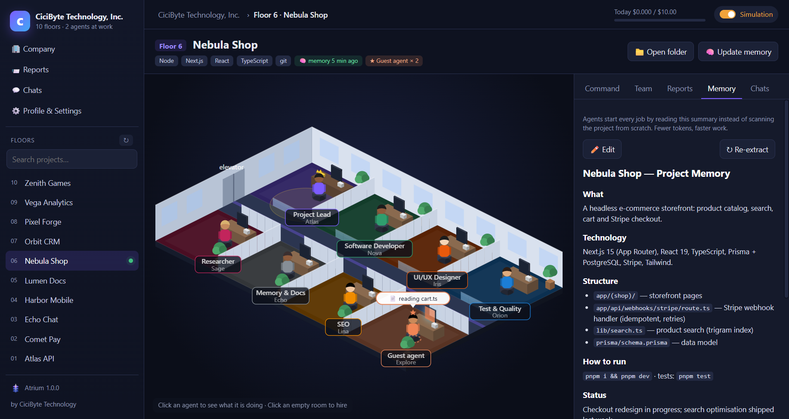 **Projektgedächtnis** — die Zusammenfassung, die jeder Agent zuerst liest. |
| 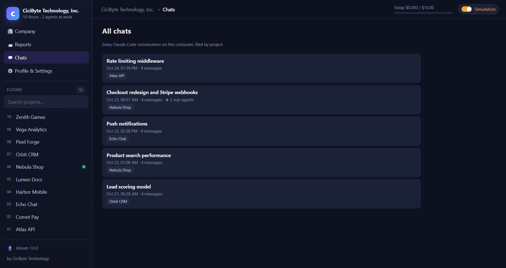 **Deine Claude-Code-Chats** — nach Projekt sortiert; setze sie direkt in Atrium fort. | 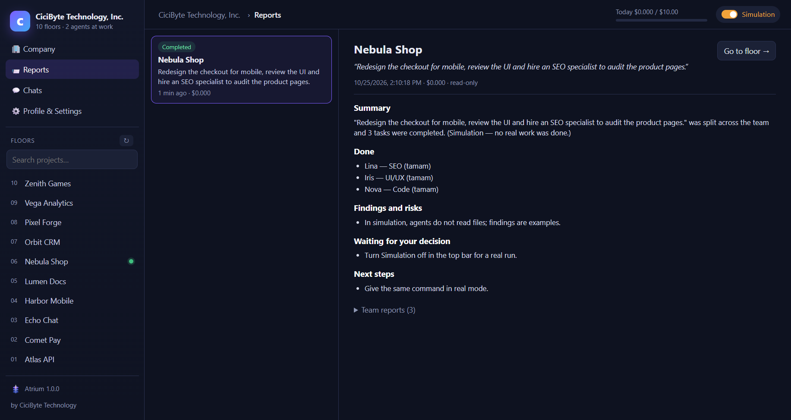 **Ein Bericht** — der Leiter führt die Arbeit des Teams zusammen. |
| 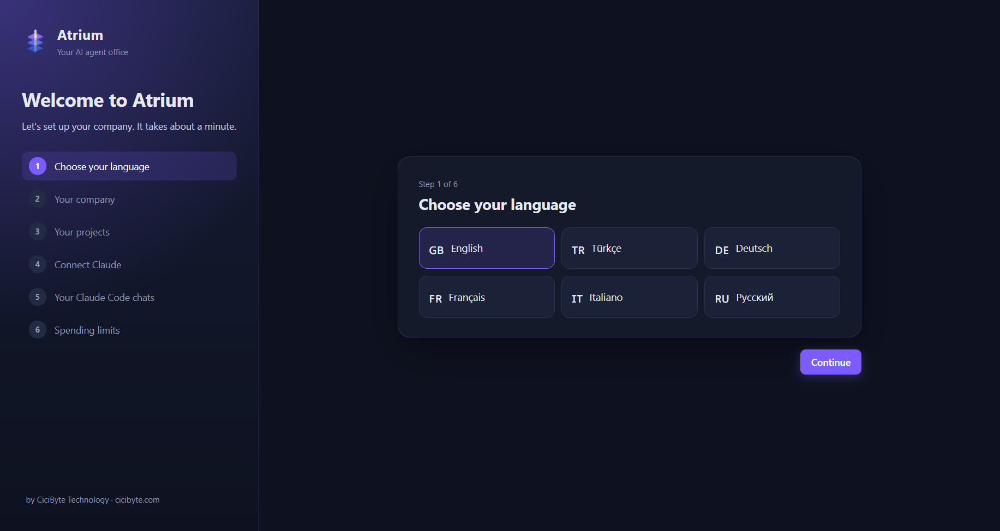 **Einrichtung beim ersten Start** — sechs Sprachen. | 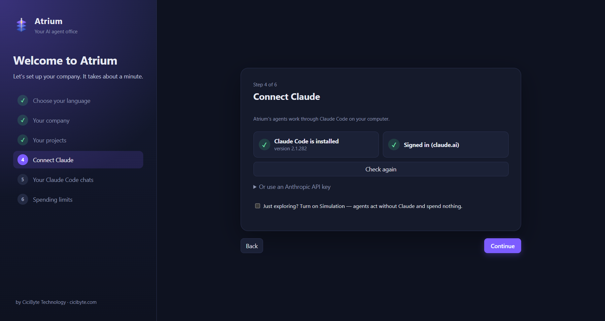 **Claude verbinden** — Atrium prüft Claude Code und die Anmeldung für dich. |

## ✨ Außerdem dabei

- 📊 **Tarif-Nutzungsanzeige** — deine Claude-Sitzungs- und Wochenlimits, live in der oberen Leiste.
- 🔔 **Eine Etage, die dich ruft** — wenn ein Claude-Code-Chat auf deine Entscheidung wartet, winkt ein Agent aus dem Fenster dieser Etage.
- 🎁 **Neuigkeiten** — Versionshinweise in deiner Sprache, angezeigt noch bevor ein Update heruntergeladen wird; die vollständige Versionsgeschichte findest du in den Einstellungen.
- 🔄 **Automatische Updates** — Atrium prüft beim Start und alle paar Minuten, lädt im Hintergrund herunter und installiert beim Neustart.
- 🔊 **Soundeffekte** und eine **integrierte Anleitung** in sechs Sprachen.

## ⬇ Installation

Lade den Installer für dein System aus dem [**neuesten Release**](https://github.com/RealMrNovember/Atrium/releases/latest) herunter:

| System | Datei |
|---|---|
| Windows 10/11 | `Atrium-Setup-x.y.z.exe` |
| macOS | `Atrium-x.y.z-arm64.dmg` / `-x64.dmg` |
| Linux | `Atrium-x.y.z-x86_64.AppImage` oder `.deb` |

> macOS-Builds sind noch nicht notarisiert: Beim ersten Mal die App per Rechtsklick → **Öffnen** starten.

### Voraussetzungen

Mindestens **ein** KI-Tool — eines davon genügt:

- Angemeldetes [Claude Code](https://docs.anthropic.com/en/docs/claude-code) (`npm install -g @anthropic-ai/claude-code`) oder ein Anthropic-API-Schlüssel (verschlüsselt im Schlüsselbund deines Betriebssystems gespeichert);
- [OpenAI Codex CLI](https://github.com/openai/codex) oder [Gemini CLI](https://github.com/google-gemini/gemini-cli);
- ein OpenAI-kompatibler Server;
- oder **ganz ohne Cloud-KI** — installiere Ollama und lokale Modelle auf der Seite **Lokale KI**.

Nur neugierig? Aktiviere die **Simulation** und erkunde alles kostenlos.

### Erster Start

Der Einrichtungsassistent führt dich durch sechs Schritte: **Sprache → Unternehmen (Name, Slogan, Logo) → Projektordner → Claude-Verbindung → deine Claude-Code-Chats → Ausgabenlimits.** Dann wächst dein Gebäude in die Höhe. Weitere KI-Tools verbindest du unter **Profil & Einstellungen → KI-Tools**.

### Aus dem Quellcode bauen

```bash
git clone https://github.com/RealMrNovember/Atrium.git
cd Atrium
npm install
npm run dev        # run with hot reload
npm run dist       # build an installer for your OS into dist/
```

## 🌍 Sechs Sprachen

English · Türkçe · Deutsch · Français · Italiano · Русский — die Oberfläche, die integrierte Anleitung, die Versionshinweise **und** die Berichte und das Gedächtnis der Agenten folgen der Sprache, die du wählst. Atrium schlägt beim ersten Start deine Systemsprache vor.

## 🛡️ Sicherheit

- Agenten **können nicht lesen**: `.env`, private Schlüssel (`*.pem`, `*.key`, `id_rsa*`, `id_ed25519*`) und andere geheime Dateien.
- Claude-Agenten und lokale Modelle **können keine Shell-Befehle ausführen**; Codex und Gemini laufen in ihrer eigenen Sandbox und erhalten dieselben Regeln.
- **Standardmäßig schreibgeschützt.** Dateiänderungen werden pro Befehl erlaubt.
- Agenten committen, pushen, installieren keine Pakete, schreiben niemandem und veröffentlichen nichts.
- Text von Webseiten und aus Dateien wird als Daten behandelt, nie als Anweisung.
- Dein Code, deine Chats und das Gedächtnis bleiben auf deinem Computer.

Eine Sicherheitslücke melden? Siehe [SECURITY.md](../../SECURITY.md).

## ❓ FAQ

<details><summary><b>Sendet Atrium meinen Code oder meine Chats irgendwohin?</b></summary>

Nein. Dein Code, deine Chats und dein Projektgedächtnis bleiben auf deinem Computer. Agenten laufen über das KI-Tool, das du wählst (Claude Code, Codex, Gemini — oder ein lokales Modell, bei dem nichts den Rechner verlässt). Atrium selbst fragt nur GitHub und atrium.cicibyte.com nach Updates und Versionshinweisen ab.
</details>

<details><summary><b>Kann ich Atrium ohne Claude nutzen?</b></summary>

Ja. Jeder Agent kann mit OpenAI Codex CLI, Gemini CLI, einem OpenAI-kompatiblen Server oder einem lokalen Modell über Ollama laufen. Atrium kann Ollama und die Modelle für dich installieren.
</details>

<details><summary><b>Brauche ich für lokale KI einen leistungsstarken Computer?</b></summary>

Nein. Kleine Modelle (1–4B) laufen auf fast jedem aktuellen Computer, sogar ohne Grafikkarte. Die Seite **Lokale KI** misst deinen Rechner und zeigt genau, welche Modelle schnell, langsam oder gar nicht laufen — und empfiehlt dir eines.
</details>

<details><summary><b>Was kostet es?</b></summary>

Atrium ist kostenlos. Agenten-Läufe nutzen deinen eigenen Claude-, ChatGPT- oder Google-Tarif oder API-Schlüssel — oder kosten mit lokalen Modellen gar nichts. Für Claude erzwingt Atrium ein Limit pro Lauf und ein Tageslimit, die du selbst festlegst.
</details>

<details><summary><b>Welche Projekte werden zu Etagen?</b></summary>

Jeder Unterordner des gewählten Ordners, außer versteckten Ordnern und Ordnern, die mit `_` beginnen. Du kannst Projekte ausschließen, Projekte aus anderen Ordnern hinzufügen und die Etagen neu anordnen.
</details>

<details><summary><b>Kann ich das Team ändern?</b></summary>

Ja — benenne Agenten um, bearbeite ihre Stellenbeschreibungen, wähle ihr KI-Tool und Modell, gib ihnen Webzugriff, verschiebe sie zwischen Zimmern oder klicke auf ein leeres Zimmer, um jemanden einzustellen. Der Leiter kann auch selbstständig Spezialisten einstellen, wenn ein Auftrag das erfordert.
</details>

## 🤝 Mitmachen

Fehlerberichte, Ideen, Übersetzungen und Pull Requests sind herzlich willkommen — siehe [CONTRIBUTING.md](../../CONTRIBUTING.md).
Atrium ist Source-available: Du darfst forken, um Beiträge zurückzusenden; bitte veröffentliche keine modifizierten Kopien.

## 💜 Unterstützung

Wenn Atrium dir Zeit spart:

- ⭐ **Gib diesem Repository einen Stern** — das hilft wirklich.
- 📣 **Teile es** mit einem Freund oder deinem Team.
- 🐛 **Melde Fehler** und schlage Funktionen vor in den [Issues](https://github.com/RealMrNovember/Atrium/issues).
- ☕ **Spendier mir einen Kaffee** — [buymeacoffee.com/mikeross](https://buymeacoffee.com/mikeross).

## Lizenz

Kostenlos nutzbar, auch kommerziell. Kopieren, Ändern oder Weiterverbreiten bedarf der schriftlichen Genehmigung.
Siehe die [Atrium-Lizenz](../../LICENSE).

<div align="center">
<br />
<a href="https://cicibyte.com"><b>CiciByte Technology, Inc.</b></a> · <a href="https://atrium.cicibyte.com">atrium.cicibyte.com</a>
</div>
