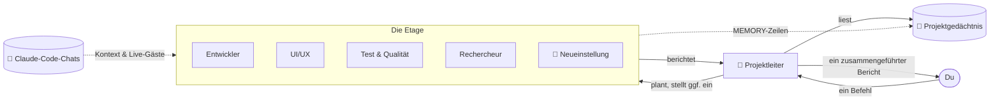

<div align="center">


# Atrium

### Dein KI-Agenten-Büro. Jedes Projekt ist eine Etage, jeder Agent hat ein eigenes Zimmer.

Gib dem Projektleiter einen einzigen Befehl — und sieh zu, wie ein Team aus Claude-Agenten zu seinen Schreibtischen geht, arbeitet
und mit einem einzigen klaren Bericht zurückkommt. Alle deine Projekte, alle deine Claude-Code-Chats, ein Gebäude.

[](https://github.com/RealMrNovember/Atrium/releases/latest)
[](https://github.com/RealMrNovember/Atrium/releases/latest)
[](#-sechs-sprachen)
[](../../LICENSE)
[](https://github.com/RealMrNovember/Atrium/stargazers)

[English](../../README.md) · [Türkçe](README.tr.md) · **Deutsch** · [Français](README.fr.md) · [Italiano](README.it.md) · [Русский](README.ru.md)

[**⬇ Herunterladen**](https://github.com/RealMrNovember/Atrium/releases/latest) · [**🌐 Showroom**](https://atrium.cicibyte.com) · [**⭐ Star geben**](https://github.com/RealMrNovember/Atrium)

<br />


</div>

---

## Warum Atrium?

Wenn du Claude Code in vielen Projekten nutzt, kennst du das Problem: Jede neue Sitzung beginnt bei null,
du wiederholst denselben Kontext, verlierst den Überblick, welches Projekt gerade was macht, und die Rechnung wächst
mit jedem „ich lese mal eben das ganze Repo noch einmal".

Atrium macht daraus ein Unternehmen, das du **sehen** kannst:

- 🏢 **Deine Projekte werden zu einem Gebäude.** Richte Atrium auf deinen Projektordner; jeder Unterordner wird zu einer Etage.
- 👥 **Jede Etage hat ein Team.** Einen Projektleiter, einen Entwickler, einen UI/UX-Designer, QA, einen Rechercheur und einen Gedächtnis-Hüter — jeder in seinem eigenen Zimmer, an seinem eigenen Schreibtisch.
- 🧭 **Du gibst einen Befehl, der Leiter führt das Team.** Der Leiter teilt die Arbeit auf, die Agenten kommen vorbei, um ihre Aufgaben abzuholen, arbeiten an ihren Schreibtischen und gehen zurück, um zu berichten. Du bekommst **einen** zusammengeführten Bericht.
- 🧠 **Projekte erinnern sich.** Jede Etage führt ein kurzes Projektgedächtnis, das jeder Agent zuerst liest — so liest niemand die ganze Codebasis erneut.
- 💬 **Deine Claude-Code-Chats ziehen ein.** Atrium liest deine bestehenden Claude-Code-Unterhaltungen und sortiert sie nach Projekt. Sub-Agenten, die Claude in diesen Chats startet, erscheinen **live** als Gäste in einem leeren Zimmer.
- 🛡️ **Du behältst die Kontrolle.** Standardmäßig schreibgeschützt, Geheimnisse sind tabu, überall gibt es Ausgabenlimits, und nichts wird je veröffentlicht oder gepusht. Das letzte Wort hast du.

## 🪙 So spart Atrium Tokens

Atrium folgt einer einzigen Idee: **Bezahle nicht zweimal für denselben Kontext.**

| Mechanismus | Was er bewirkt |
|---|---|
| **Projektgedächtnis** | Eine kompakte Markdown-Zusammenfassung pro Projekt (was es ist, Stack, Struktur, wie man es startet, Entscheidungen, letzte Arbeiten, Erkenntnisse). Jeder Agent liest sie *zuerst* und soll nur die Dateien öffnen, die er braucht, statt das Repo zu durchsuchen. |
| **Selbstaktualisierendes Gedächtnis** | Nach jedem Auftrag landet die Zusammenfassung des Leiters unter *Letzte Arbeiten* und die `MEMORY:`-Zeilen der Agenten unter *Gelernt*. Der nächste Auftrag startet klüger — ohne dieselben Fakten neu zu entdecken. |
| **Chats werden zu Kontext** | Beim Extrahieren des Gedächtnisses werden die Titel und Eingangsanfragen deiner früheren Claude-Code-Chats zu diesem Projekt einbezogen — deine Ziele und Entscheidungen bleiben erhalten, ohne dass du sie erneut einfügen musst. |
| **Das richtige Modell für die Aufgabe** | Der Gedächtnis-Hüter läuft standardmäßig auf Haiku; du wählst pro Agent zwischen Haiku / Sonnet / Opus. |
| **Günstig planen, günstig zusammenführen** | Der Leiter plant mit schreibgeschützten Werkzeugen und kleinem Budget und führt Berichte **ganz ohne Werkzeuge** zusammen. |
| **Fokussierte Aufgaben** | Jeder Agent erhält eine in sich geschlossene Aufgabe, nicht die ganze Unterhaltung. |
| **Harte Limits** | Budget pro Lauf, Zeitlimit pro Lauf und ein unternehmensweites Tageslimit. Wenn ein Lauf in ein Timeout läuft und seine Kosten nicht ausgelesen werden können, wird das **volle Limit angerechnet** — das Tageslimit wird nie zu niedrig gezählt. |
| **Simulationsmodus** | Erkunde die ganze App, Animationen und Abläufe, ohne einen Cent auszugeben. |

## So funktioniert's



1. **Befehl.** Öffne eine Etage und sag dem Leiter, was du willst. Erlaube Dateiänderungen nur, wenn du Änderungen willst.
2. **Plan.** Der Leiter liest das Projektgedächtnis, teilt die Arbeit in bis zu vier Aufgaben auf und — wenn niemand passt — **stellt einen Spezialisten ein**, der aus dem Aufzug in ein leeres Zimmer geht.
3. **Arbeit.** Die Agenten gehen ins Büro des Leiters, um ihre Aufgabe abzuholen, kehren an ihren Schreibtisch zurück und arbeiten. Ihre Bildschirme leuchten auf, und eine Sprechblase zeigt, was sie gerade tun (`📄 reading cart.ts`, `🔎 searching "calculateTotal"`).
4. **Bericht.** Jeder Agent geht mit einem Bericht zurück; der Leiter führt alles zusammen zu *Zusammenfassung · Erledigt · Erkenntnisse & Risiken · Wartet auf deine Entscheidung · Nächste Schritte*.
5. **Erinnern.** Erkenntnisse wandern für das nächste Mal ins Projektgedächtnis.

## 📸 Screenshots

| | |
|---|---|
|  **Das Gebäude** — jedes Projekt ist eine Etage; beleuchtete Fenster bedeuten, dass Agenten arbeiten. |  **Projektgedächtnis** — die Zusammenfassung, die jeder Agent zuerst liest. |
|  **Deine Claude-Code-Chats** — nach Projekt sortiert, mit Anzahl der Sub-Agenten. |  **Ein Bericht** — der Leiter führt die Arbeit des Teams zusammen. |
|  **Einrichtung beim ersten Start** — sechs Sprachen. |  **Claude verbinden** — Atrium prüft Claude Code und die Anmeldung für dich. |

## ⬇ Installation

Lade das Installationsprogramm für dein System von der [**neuesten Version**](https://github.com/RealMrNovember/Atrium/releases/latest) herunter:

| System | Datei |
|---|---|
| Windows 10/11 | `Atrium-Setup-x.y.z.exe` |
| macOS | `Atrium-x.y.z-arm64.dmg` / `-x64.dmg` |
| Linux | `Atrium-x.y.z-x86_64.AppImage` oder `.deb` |

> macOS-Builds sind noch nicht notarisiert: Beim ersten Mal die App per Rechtsklick → **Öffnen** starten.

### Voraussetzungen

- [Claude Code](https://docs.anthropic.com/en/docs/claude-code) ist installiert (`npm install -g @anthropic-ai/claude-code`) und angemeldet — oder ein Anthropic-API-Schlüssel, den Atrium verschlüsselt im Schlüsselbund deines Betriebssystems speichert.
- Noch kein Claude? Aktiviere die **Simulation** und erkunde alles kostenlos.

### Erster Start

Der Einrichtungsassistent führt dich durch sechs Schritte: **Sprache → Unternehmen (Name, Slogan, Logo) → Projektordner → Claude-Verbindung → deine Claude-Code-Chats → Ausgabenlimits.** Dann wächst dein Gebäude in die Höhe.

### Aus dem Quellcode bauen

```bash
git clone https://github.com/RealMrNovember/Atrium.git
cd Atrium
npm install
npm run dev        # run with hot reload
npm run dist       # build an installer for your OS into dist/
```

## 🌍 Sechs Sprachen

English · Türkçe · Deutsch · Français · Italiano · Русский — die Oberfläche **und** die Berichte und das Gedächtnis der Agenten folgen der Sprache, die du wählst. Atrium schlägt beim ersten Start deine Systemsprache vor.

## 🛡️ Sicherheit

- Agenten **können nicht lesen**: `.env`, private Schlüssel (`*.pem`, `*.key`, `id_rsa*`, `id_ed25519*`) — und sie **können keine Shell-Befehle ausführen**.
- **Standardmäßig schreibgeschützt.** Dateiänderungen werden pro Befehl erlaubt; dann arbeiten die Agenten nacheinander.
- Agenten committen, pushen, installieren keine Pakete, schreiben niemandem und veröffentlichen nichts.
- Text von Webseiten und aus Dateien wird als Daten behandelt, nie als Anweisung.
- Alles bleibt auf deinem Computer: Chats werden lokal gelesen, Daten liegen in deinem Benutzerordner.

Eine Sicherheitslücke melden? Siehe [SECURITY.md](../../SECURITY.md).

## ❓ FAQ

<details><summary><b>Sendet Atrium meinen Code oder meine Chats irgendwohin?</b></summary>

Nein. Atrium selbst hat keinen Server. Agenten laufen über Claude Code auf deinem Rechner, genau wie wenn du Claude Code direkt nutzt.
</details>

<details><summary><b>Was kostet es?</b></summary>

Atrium ist kostenlos. Agenten-Läufe nutzen deinen Claude-Code-Tarif oder deinen API-Schlüssel; Atrium erzwingt ein Limit pro Lauf und ein Tageslimit, die du selbst festlegst.
</details>

<details><summary><b>Welche Projekte werden zu Etagen?</b></summary>

Jeder Unterordner des gewählten Ordners, außer versteckten Ordnern und Ordnern, die mit `_` beginnen.
</details>

<details><summary><b>Kann ich das Team ändern?</b></summary>

Ja — benenne Agenten um, bearbeite ihre Stellenbeschreibungen, wähle ihr Modell, gib ihnen Webzugriff, verschiebe sie zwischen Zimmern oder klicke auf ein leeres Zimmer, um jemanden einzustellen. Der Leiter kann auch selbstständig Spezialisten einstellen, wenn ein Auftrag das erfordert.
</details>

## 🤝 Mitmachen

Fehlerberichte, Ideen, Übersetzungen und Pull Requests sind herzlich willkommen — siehe [CONTRIBUTING.md](../../CONTRIBUTING.md).
Atrium ist Source-available: Du darfst forken, um Beiträge zurückzusenden; bitte veröffentliche keine modifizierten Kopien.

## 💜 Unterstützung

Atrium ist kostenlos und bleibt es auch. Wenn es dir Zeit spart:

- ⭐ **Gib diesem Repository einen Stern** — das hilft wirklich.
- 📣 **Teile es** mit einem Freund oder deinem Team.
- 🐛 **Melde Fehler** und schlage Funktionen vor in den [Issues](https://github.com/RealMrNovember/Atrium/issues).
- ☕ **Sponsoring** — Spendenlinks findest du im [Showroom](https://atrium.cicibyte.com/#support).

## Lizenz

Kostenlos nutzbar, auch kommerziell. Kopieren, Ändern oder Weiterverbreiten bedarf der schriftlichen Genehmigung.
Siehe die [Atrium-Lizenz](../../LICENSE).

<div align="center">
<br />
<a href="https://cicibyte.com"><b>CiciByte Technology, Inc.</b></a> · <a href="https://atrium.cicibyte.com">atrium.cicibyte.com</a>
</div>
