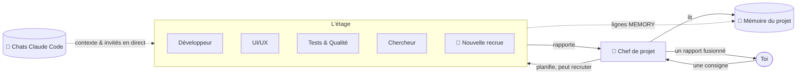

<div align="center">


# Atrium

### Ton bureau d'agents IA. Chaque projet est un étage, chaque agent a sa pièce.

Donne une seule consigne à un chef de projet — regarde une équipe d'agents Claude rejoindre ses bureaux, travailler
et revenir avec un seul rapport clair. Tous tes projets, tous tes chats Claude Code, un seul immeuble.

[](https://github.com/RealMrNovember/Atrium/releases/latest)
[](https://github.com/RealMrNovember/Atrium/releases/latest)
[](#-six-langues)
[](../../LICENSE)
[](https://github.com/RealMrNovember/Atrium/stargazers)

[English](../../README.md) · [Türkçe](README.tr.md) · [Deutsch](README.de.md) · **Français** · [Italiano](README.it.md) · [Русский](README.ru.md)

[**⬇ Télécharger**](https://github.com/RealMrNovember/Atrium/releases/latest) · [**🌐 Showroom**](https://atrium.cicibyte.com) · [**⭐ Mettre une étoile**](https://github.com/RealMrNovember/Atrium)

<br />


</div>

---

## Pourquoi Atrium ?

Si tu utilises Claude Code sur de nombreux projets, tu connais le problème : chaque nouvelle session repart de zéro,
tu répètes le même contexte, tu perds de vue quel projet fait quoi, et la facture grimpe
à chaque « je relis tout le dépôt une fois de plus ».

Atrium en fait une entreprise que tu peux **voir** :

- 🏢 **Tes projets deviennent un immeuble.** Pointe Atrium vers ton dossier de projets ; chaque sous-dossier devient un étage.
- 👥 **Chaque étage a une équipe.** Un chef de projet, un développeur, un designer UI/UX, un QA, un chercheur et un gardien de la mémoire — chacun dans sa propre pièce, à son propre bureau.
- 🧭 **Tu donnes une seule consigne, le chef dirige l'équipe.** Le chef répartit le travail, les agents viennent chercher leurs tâches, travaillent à leurs bureaux et reviennent faire leur rapport. Tu reçois **un seul** rapport fusionné.
- 🧠 **Les projets se souviennent.** Chaque étage garde une courte mémoire de projet que chaque agent lit en premier — personne ne relit donc toute la base de code.
- 💬 **Tes chats Claude Code emménagent.** Atrium lit tes conversations Claude Code existantes et les range par projet. Les sous-agents que Claude lance dans ces chats apparaissent **en direct** comme invités dans une pièce vide.
- 🛡️ **Tu gardes la main.** Lecture seule par défaut, secrets interdits d'accès, plafonds de dépenses partout, et rien n'est jamais publié ni poussé. Le dernier mot est le tien.

## 🪙 Comment Atrium économise des tokens

Atrium repose sur une seule idée : **ne pas payer deux fois pour le même contexte.**

| Mécanisme | Ce qu'il fait |
|---|---|
| **Mémoire de projet** | Un résumé Markdown compact par projet (ce que c'est, stack, structure, comment le lancer, décisions, travaux récents, enseignements). Chaque agent le lit *en premier* et doit n'ouvrir que les fichiers dont il a besoin au lieu de parcourir le dépôt. |
| **Mémoire auto-actualisée** | Après chaque tâche, le résumé du chef va dans *Travaux récents* et les lignes `MEMORY:` des agents dans *Appris*. La tâche suivante démarre plus intelligemment — sans redécouvrir les mêmes faits. |
| **Les chats deviennent du contexte** | Lors de l'extraction de la mémoire, les titres et les demandes initiales de tes anciens chats Claude Code pour ce projet sont inclus — tes objectifs et décisions se transmettent sans avoir à les recoller. |
| **Le bon modèle pour chaque tâche** | Le gardien de la mémoire tourne par défaut sur Haiku ; tu choisis Haiku / Sonnet / Opus pour chaque agent. |
| **Planification et fusion à bas coût** | Le chef planifie avec des outils en lecture seule et un petit budget, et fusionne les rapports **sans aucun outil**. |
| **Tâches ciblées** | Chaque agent reçoit une tâche autonome, pas toute la conversation. |
| **Plafonds stricts** | Budget par exécution, limite de temps par exécution et plafond quotidien pour toute l'entreprise. Si une exécution dépasse le délai et que son coût est illisible, le **plafond complet est comptabilisé** — le plafond quotidien n'est jamais sous-estimé. |
| **Mode simulation** | Explore toute l'appli, les animations et les parcours sans dépenser un centime. |

## Comment ça marche



1. **Consigne.** Ouvre un étage et dis au chef ce que tu veux. N'autorise les modifications de fichiers que si tu veux des changements.
2. **Plan.** Le chef lit la mémoire du projet, répartit le travail en quatre tâches maximum et — si personne ne convient — **recrute un spécialiste** qui sort de l'ascenseur vers une pièce vide.
3. **Travail.** Les agents se rendent au bureau du chef pour récupérer leur tâche, retournent à leur bureau et travaillent. Leurs écrans s'allument et une bulle indique ce qu'ils font à l'instant (`📄 reading cart.ts`, `🔎 searching "calculateTotal"`).
4. **Rapport.** Chaque agent revient avec un rapport ; le chef fusionne le tout en *Résumé · Fait · Constats & risques · En attente de ta décision · Prochaines étapes*.
5. **Mémoire.** Les enseignements sont ajoutés à la mémoire du projet pour la prochaine fois.

## 📸 Captures d'écran

| | |
|---|---|
|  **L'immeuble** — chaque projet est un étage ; les fenêtres éclairées signifient que des agents travaillent. |  **Mémoire du projet** — le résumé que chaque agent lit en premier. |
|  **Tes chats Claude Code** — rangés par projet, avec le nombre de sous-agents. |  **Un seul rapport** — le chef fusionne le travail de l'équipe. |
|  **Configuration au premier lancement** — six langues. |  **Connecter Claude** — Atrium vérifie Claude Code et la connexion pour toi. |

## ⬇ Installation

Télécharge l'installateur pour ton système depuis la [**dernière version**](https://github.com/RealMrNovember/Atrium/releases/latest) :

| Système | Fichier |
|---|---|
| Windows 10/11 | `Atrium-Setup-x.y.z.exe` |
| macOS | `Atrium-x.y.z-arm64.dmg` / `-x64.dmg` |
| Linux | `Atrium-x.y.z-x86_64.AppImage` ou `.deb` |

> Les versions macOS ne sont pas encore notarisées : la première fois, clic droit sur l'appli → **Ouvrir**.

### Prérequis

- [Claude Code](https://docs.anthropic.com/en/docs/claude-code) installé (`npm install -g @anthropic-ai/claude-code`) et connecté — ou une clé d'API Anthropic, qu'Atrium stocke chiffrée dans le trousseau de ton système.
- Pas encore de Claude ? Active la **Simulation** et explore tout gratuitement.

### Premier lancement

L'assistant de configuration te guide en six étapes : **langue → entreprise (nom, slogan, logo) → dossier des projets → connexion à Claude → tes chats Claude Code → limites de dépenses.** Ensuite, ton immeuble sort de terre.

### Compiler depuis les sources

```bash
git clone https://github.com/RealMrNovember/Atrium.git
cd Atrium
npm install
npm run dev        # run with hot reload
npm run dist       # build an installer for your OS into dist/
```

## 🌍 Six langues

English · Türkçe · Deutsch · Français · Italiano · Русский — l'interface **et** les rapports et la mémoire des agents suivent la langue que tu choisis. Atrium te propose la langue de ton système au premier lancement.

## 🛡️ Sécurité

- Les agents **ne peuvent pas lire** `.env`, les clés privées (`*.pem`, `*.key`, `id_rsa*`, `id_ed25519*`) et **ne peuvent pas exécuter de commandes shell**.
- **Lecture seule par défaut.** Les modifications de fichiers sont autorisées commande par commande ; les agents travaillent alors un par un.
- Les agents ne font jamais de commit ni de push, n'installent aucun paquet, n'écrivent à personne et ne publient rien.
- Le texte provenant de pages web et de fichiers est traité comme des données, jamais comme des instructions.
- Tout reste sur ton ordinateur : les chats sont lus localement, les données vivent dans ton dossier utilisateur.

Consulte [SECURITY.md](../../SECURITY.md) pour signaler une vulnérabilité.

## ❓ FAQ

<details><summary><b>Atrium envoie-t-il mon code ou mes chats quelque part ?</b></summary>

Non. Atrium n'a pas de serveur. Les agents s'exécutent via Claude Code sur ta machine, exactement comme quand tu utilises Claude Code directement.
</details>

<details><summary><b>Combien ça coûte ?</b></summary>

Atrium est gratuit. Les exécutions d'agents utilisent ton forfait Claude Code ou ta clé d'API ; Atrium applique un plafond par exécution et un plafond quotidien que tu choisis.
</details>

<details><summary><b>Quels projets deviennent des étages ?</b></summary>

Chaque sous-dossier du dossier que tu choisis, sauf les dossiers cachés et ceux qui commencent par `_`.
</details>

<details><summary><b>Puis-je modifier l'équipe ?</b></summary>

Oui — renomme les agents, modifie leurs fiches de poste, choisis leur modèle, donne-leur un accès web, déplace-les d'une pièce à l'autre, ou clique sur une pièce vide pour recruter. Le chef peut aussi recruter des spécialistes de lui-même quand une tâche l'exige.
</details>

## 🤝 Contribuer

Rapports de bugs, idées, traductions et pull requests sont les bienvenus — voir [CONTRIBUTING.md](../../CONTRIBUTING.md).
Atrium est « source-available » : tu peux faire un fork pour renvoyer des contributions ; merci de ne pas publier de copies modifiées.

## 💜 Soutien

Atrium est gratuit et le restera. S'il te fait gagner du temps :

- ⭐ **Mets une étoile à ce dépôt** — ça aide vraiment.
- 📣 **Partage-le** avec un ami ou ton équipe.
- 🐛 **Signale des bugs** et suggère des fonctionnalités dans les [Issues](https://github.com/RealMrNovember/Atrium/issues).
- ☕ **Sponsoring** — les liens de dons sont sur le [showroom](https://atrium.cicibyte.com/#support).

## Licence

Utilisation gratuite, y compris commerciale. Copier, modifier ou redistribuer nécessite une autorisation écrite.
Voir la [Licence Atrium](../../LICENSE).

<div align="center">
<br />
<a href="https://cicibyte.com"><b>CiciByte Technology, Inc.</b></a> · <a href="https://atrium.cicibyte.com">atrium.cicibyte.com</a>
</div>
