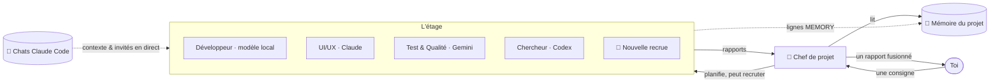
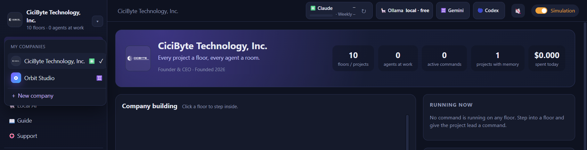
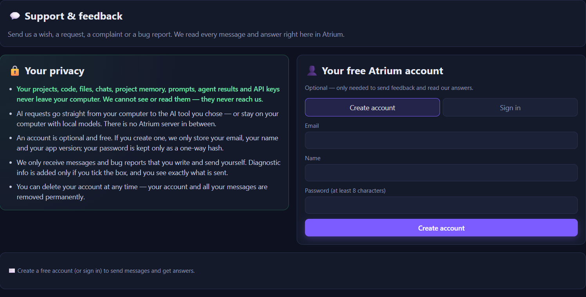

<div align="center">


# Atrium

### Ton bureau d'agents IA. Chaque projet est un étage, chaque agent a sa pièce.

Donne une seule consigne à un chef de projet — regarde une équipe d'agents IA rejoindre ses bureaux, travailler
et revenir avec un seul rapport clair. Claude, Codex, Gemini ou des **modèles locaux gratuits** sur ton propre ordinateur —
tous tes projets, tous tes chats Claude Code, un seul immeuble.

[](https://github.com/RealMrNovember/Atrium/releases/latest)
[](https://github.com/RealMrNovember/Atrium/releases)
[](https://github.com/RealMrNovember/Atrium/releases/latest)
[](#-fonctionne-avec-ton-ia)
[](#-confidentialité)
[](#-six-langues)
[](../../LICENSE)
[](https://github.com/RealMrNovember/Atrium/stargazers)
[](https://buymeacoffee.com/mikeross)

[English](../../README.md) · [Türkçe](README.tr.md) · [Deutsch](README.de.md) · **Français** · [Italiano](README.it.md) · [Русский](README.ru.md)

[**⬇ Télécharger**](https://github.com/RealMrNovember/Atrium/releases/latest) · [**🌐 Showroom**](https://atrium.cicibyte.com) · [**📜 Nouveautés**](https://github.com/RealMrNovember/Atrium/releases) · [**⭐ Mettre une étoile**](https://github.com/RealMrNovember/Atrium)

<br />


</div>

---

## Pourquoi Atrium ?

Si tu utilises des agents de code IA sur de nombreux projets, tu connais le problème : chaque nouvelle session repart de zéro,
tu répètes le même contexte, tu perds de vue quel projet fait quoi, et la facture grimpe
à chaque « je relis tout le dépôt une fois de plus ».

Atrium en fait une entreprise que tu peux **voir** :

- 🏢 **Tes projets deviennent un immeuble.** Pointe Atrium vers ton dossier de projets ; chaque sous-dossier devient un étage.
- 👥 **Chaque étage a une équipe.** Un chef de projet, un développeur, un designer UI/UX, un QA, un chercheur et un gardien de la mémoire — chacun dans sa propre pièce, à son propre bureau.
- 🧭 **Tu donnes une seule consigne, le chef dirige l'équipe.** Le chef répartit le travail, les agents viennent chercher leurs tâches, travaillent à leurs bureaux et reviennent faire leur rapport. Tu reçois **un seul** rapport fusionné.
- 🧠 **Les projets se souviennent.** Chaque étage garde une courte mémoire de projet que chaque agent lit en premier — personne ne relit donc toute la base de code.
- 🤝 **Pas seulement Claude.** Chaque agent peut tourner avec Claude Code, OpenAI Codex CLI, Gemini CLI, Ollama ou tout serveur compatible OpenAI — mélangés sur le même étage.
- 🦙 **IA locale intégrée.** Atrium mesure ton ordinateur, montre quels modèles ouverts vont tourner, télécharge et installe Ollama et les modèles pour toi, et n'importe quel agent peut les utiliser — gratuit, hors ligne et privé.
- 💬 **Tes chats Claude Code emménagent.** Atrium lit tes conversations Claude Code existantes et les range par projet. Les chats ouverts illuminent leur étage, et quand un chat attend ta décision, un agent se penche à la fenêtre pour t'appeler.
- 🏙️ **Plusieurs entreprises, une seule app.** Gère ton studio et tes clients côte à côte — chaque entreprise avec ses propres projets, son équipe, sa mémoire et son IA.
- 🔒 **Privé par conception.** Ton code, tes chats, ta mémoire et tes clés ne quittent jamais ton ordinateur. Nous ne pouvons pas les voir — ils ne nous parviennent jamais.
- 🛟 **Assistance intégrée.** Envoie un souhait, une demande, une réclamation ou un rapport de bug depuis l'app et lis la réponse sur place.
- 🛡️ **Tu gardes la main.** Lecture seule par défaut, secrets interdits d'accès, plafonds de dépenses partout, et rien n'est jamais publié ni poussé. Le dernier mot est le tien.

## 🤖 Fonctionne avec ton IA

Choisis l'IA de chaque agent — ton chef peut être Claude pendant que le développeur utilise un modèle de code local et que le chercheur utilise Gemini.

| Outil d'IA | Ce qu'il te faut | Idéal pour |
|---|---|---|
| ✳️ **Claude Code** | [Claude Code](https://docs.anthropic.com/en/docs/claude-code) connecté, ou une clé d'API Anthropic | Les agents les plus puissants ; compteur d'utilisation du forfait et plafonds en dollars |
| 🌀 **OpenAI Codex CLI** | `npm i -g @openai/codex`, puis **Se connecter** dans Atrium | Des agents sur ton forfait ChatGPT |
| ♊ **Gemini CLI** | `npm i -g @google/gemini-cli`, connexion Google ou une clé d'API Gemini | Des agents sur ton compte Google |
| 🦙 **Ollama** | Rien — Atrium l'installe depuis la page **IA locale** | Un travail gratuit, hors ligne et privé |
| 🔌 **Compatible OpenAI** | Une adresse (LM Studio, llama.cpp, vLLM, OpenRouter, OpenAI API) | Les modèles que tu héberges déjà |

<table><tr>
<td width="50%"></td>
<td width="50%"></td>
</tr><tr>
<td align="center"><b>Une équipe, plusieurs IA</b> — chaque agent affiche son outil et son modèle.</td>
<td align="center"><b>Change en deux clics</b> — outil d'IA et modèle pour chaque agent.</td>
</tr></table>

## 🦙 IA locale

Fais tourner tes agents sur des modèles ouverts installés sur ton propre ordinateur — pas de compte, pas d'abonnement, aucune donnée ne quitte la machine.

1. **Mesurer.** Atrium lit ton processeur, ta mémoire, ta carte graphique et ton espace disque libre, et t'indique quelles tailles de modèles tourneront bien.
2. **Installer le moteur.** Un clic télécharge la version officielle d'Ollama et l'installe — pas besoin de terminal.
3. **Télécharger un modèle.** Un catalogue de 37 modèles ouverts (généralistes, code, raisonnement, vision, embeddings et plus), chacun marqué 🟢 *Tourne vite*, 🟡 *Tourne lentement* ou 🔴 *Trop gros* pour **ta** machine, avec une recommandation ⭐.
4. **Essaie-le et recrute-le.** Discute avec le modèle directement sur la page, puis confie-le à n'importe quel agent.

Les modèles marqués **Peut être un agent** ouvrent et lisent les fichiers du projet via les outils sûrs d'Atrium : ils restent dans le dossier du projet, n'ouvrent jamais les fichiers secrets et n'exécutent jamais de commandes shell.

<table><tr>
<td width="50%"></td>
<td width="50%"></td>
</tr><tr>
<td align="center"><b>Ton ordinateur, mesuré</b> — état du moteur et tes modèles.</td>
<td align="center"><b>Un catalogue qui connaît ton matériel</b> — téléchargement en un clic.</td>
</tr></table>

## 🔒 Confidentialité

Atrium est conçu pour que **ton travail ne nous parvienne jamais**.

| | Quoi | Où ça va |
|---|---|---|
| 🚫 **Jamais** | Tes projets, ton code, tes fichiers, tes chats, la mémoire de projet, tes prompts, les résultats des agents, tes clés API | Reste sur ton ordinateur. Les requêtes d'IA vont directement à l'outil d'IA que tu as choisi — ou nulle part avec les modèles locaux. |
| ✋ **Seulement si tu le choisis** | Un compte gratuit (e-mail, nom, version de l'app — le mot de passe uniquement sous forme de hachage irréversible), les messages et rapports de bug que tu écris et envoies | Le serveur d'assistance d'Atrium. Les infos de diagnostic ne sont ajoutées que si tu coches la case, et tu vois exactement ce qui est envoyé. |
| 🔄 **Vérification des mises à jour** | La version de l'app | GitHub et atrium.cicibyte.com, pour proposer les mises à jour et afficher les notes de version. |

Tu peux supprimer ton compte à tout moment — ton compte et tous tes messages sont définitivement effacés.

## 🪙 Comment Atrium économise des tokens

Atrium repose sur une seule idée : **ne pas payer deux fois pour le même contexte.**

| Mécanisme | Ce qu'il fait |
|---|---|
| **Mémoire de projet** | Un résumé Markdown compact par projet (ce que c'est, stack, structure, comment le lancer, décisions, travaux récents, enseignements). Chaque agent le lit *en premier* et doit n'ouvrir que les fichiers dont il a besoin au lieu de parcourir le dépôt. |
| **Mémoire auto-actualisée** | Après chaque tâche, le résumé du chef va dans *Travaux récents* et les lignes `MEMORY:` des agents dans *Appris*. La tâche suivante démarre plus intelligemment — sans redécouvrir les mêmes faits. |
| **Dossiers ciblés** | Chaque agent sait dans quels dossiers il travaille et commence par là. |
| **Les chats deviennent du contexte** | Lors de l'extraction de la mémoire, les titres et les demandes initiales de tes anciens chats Claude Code pour ce projet sont inclus — tes objectifs et décisions se transmettent sans avoir à les recoller. |
| **Le bon modèle pour chaque tâche** | Haiku pour le gardien de la mémoire, Sonnet ou Opus là où ça compte — ou un modèle local gratuit pour le travail de routine. |
| **Planification et fusion à bas coût** | Le chef planifie avec des outils en lecture seule et un petit budget, et fusionne les rapports **sans aucun outil**. |
| **Plafonds stricts** | Budget par exécution, limite de temps par exécution et plafond quotidien pour toute l'entreprise. Si une exécution dépasse le délai et que son coût est illisible, le **plafond complet est comptabilisé** — le plafond quotidien n'est jamais sous-estimé. |
| **Mode simulation** | Explore toute l'appli, les animations et les parcours sans dépenser un centime. |

## Comment ça marche



1. **Consigne.** Ouvre un étage et dis au chef ce que tu veux. N'autorise les modifications de fichiers que si tu veux des changements. Ou clique sur **Tour de statut** et le chef passe de bureau en bureau pour recueillir les rapports.
2. **Plan.** Le chef lit la mémoire du projet, répartit le travail en quatre tâches maximum et — si personne ne convient — **recrute un spécialiste** qui sort de l'ascenseur vers une pièce vide.
3. **Travail.** Les agents se rendent au bureau du chef pour récupérer leur tâche, retournent à leur bureau et travaillent. Leurs écrans s'allument et une bulle indique ce qu'ils font à l'instant (`📄 reading cart.ts`, `🔎 searching "calculateTotal"`).
4. **Rapport.** Chaque agent revient avec un rapport ; le chef fusionne le tout en *Résumé · Fait · Constats & risques · En attente de ta décision · Prochaines étapes*.
5. **Mémoire.** Les enseignements sont ajoutés à la mémoire du projet pour la prochaine fois.

## 📸 Plus de captures d'écran

| | |
|---|---|
|  **L'immeuble** — chaque projet est un étage ; les fenêtres lumineuses signalent du travail, les fenêtres chaudes un chat ouvert. |  **Mémoire du projet** — le résumé que chaque agent lit en premier. |
|  **Tes chats Claude Code** — rangés par projet, à continuer directement dans Atrium. |  **Un seul rapport** — le chef fusionne le travail de l'équipe. |
|  **Configuration au premier lancement** — six langues. |  **Connecter Claude** — Atrium vérifie Claude Code et la connexion pour toi. |

## 🏙️ Entreprises, projets et discussions

- **Plusieurs entreprises.** Le menu ▾ à côté du nom de ton entreprise permet de changer d'entreprise ou d'en ajouter une. Chaque entreprise garde ses propres projets, son équipe, sa mémoire, ses rapports et son outil d'IA par défaut — une entreprise peut tourner sur Claude, une autre sur des modèles locaux.
- **Partir de zéro.** Pas encore de projets ? Crée le premier directement dans l'assistant de configuration, ou avec **＋** à côté de *Étages*.
- **Nouvelles discussions.** Lance une nouvelle discussion Claude Code dans n'importe quel projet depuis son onglet *Discussions* ; elle est enregistrée et peut être reprise n'importe où.
- **Joindre des fichiers.** Dépose des images, des PDF ou des fichiers texte sur le champ de commande — l'équipe les reçoit avec la commande.

<table><tr>
<td width="50%"></td>
<td width="50%"></td>
</tr><tr>
<td align="center"><b>Plusieurs entreprises</b> — chacune avec son équipe et son IA.</td>
<td align="center"><b>Assistance intégrée</b> — et une promesse de confidentialité que tu peux lire.</td>
</tr></table>

## ✨ Et aussi

- 📊 **Une carte d'utilisation par outil d'IA** — limites de session et hebdomadaires de Claude, limites de Codex, exécutions et tokens du jour pour les autres, *local · gratuit* pour Ollama.
- ⚡ **Connexion en un clic** — *Se connecter avec ChatGPT*, *Se connecter avec Google* et *Connecter Claude* installent l'outil si besoin et ouvrent sa page de connexion.
- 🔔 **Un étage qui t'appelle** — quand un chat Claude Code attend ta décision, un agent fait signe depuis la fenêtre de cet étage.
- 🎁 **Nouveautés** — les notes de version dans ta langue, affichées avant même le téléchargement d'une mise à jour ; l'historique complet des versions dans les réglages.
- 🔄 **Mises à jour automatiques** — Atrium vérifie au lancement et toutes les quelques minutes, télécharge en arrière-plan et installe au redémarrage.
- 🔊 **Effets sonores** et un **guide intégré** en six langues.

## ⬇ Installation

Télécharge l'installateur pour ton système depuis la [**dernière version**](https://github.com/RealMrNovember/Atrium/releases/latest) :

| Système | Fichier |
|---|---|
| Windows 10/11 | `Atrium-Setup-x.y.z.exe` |
| macOS | `Atrium-x.y.z-arm64.dmg` / `-x64.dmg` |
| Linux | `Atrium-x.y.z-x86_64.AppImage` ou `.deb` |

> Les versions macOS ne sont pas encore notarisées : la première fois, clic droit sur l'appli → **Ouvrir**.

### Prérequis

Au moins **un** outil d'IA — n'importe lequel suffit :

- [Claude Code](https://docs.anthropic.com/en/docs/claude-code) (`npm install -g @anthropic-ai/claude-code`) connecté, ou une clé d'API Anthropic (stockée chiffrée dans le trousseau de ton système) ;
- [OpenAI Codex CLI](https://github.com/openai/codex) ou [Gemini CLI](https://github.com/google-gemini/gemini-cli) ;
- un serveur compatible OpenAI ;
- ou **aucune IA cloud** — installe Ollama et des modèles locaux depuis la page **IA locale**.

Simple curiosité ? Active la **Simulation** et explore tout gratuitement.

### Premier lancement

L'assistant de configuration te guide en six étapes : **langue → entreprise (nom, slogan, logo) → projets (choisis un dossier ou crée ton premier projet) → IA (Claude, ChatGPT/Codex, Gemini, Ollama — un clic chacun) → tes chats Claude Code → limites de dépenses.** Ensuite, ton immeuble sort de terre.

### Compiler depuis les sources

```bash
git clone https://github.com/RealMrNovember/Atrium.git
cd Atrium
npm install
npm run dev        # run with hot reload
npm run dist       # build an installer for your OS into dist/
```

## 🌍 Six langues

English · Türkçe · Deutsch · Français · Italiano · Русский — l'interface, le guide intégré, les notes de version **et** les rapports et la mémoire des agents suivent la langue que tu choisis. Atrium te propose la langue de ton système au premier lancement.

## 🛡️ Sécurité

- Les agents **ne peuvent pas lire** `.env`, les clés privées (`*.pem`, `*.key`, `id_rsa*`, `id_ed25519*`) ni les autres fichiers secrets.
- Les agents Claude et les modèles locaux **ne peuvent pas exécuter de commandes shell** ; Codex et Gemini tournent dans leur propre bac à sable et reçoivent les mêmes règles.
- **Lecture seule par défaut.** Les modifications de fichiers sont autorisées commande par commande.
- Les agents ne font jamais de commit ni de push, n'installent aucun paquet, n'écrivent à personne et ne publient rien.
- Le texte provenant de pages web et de fichiers est traité comme des données, jamais comme des instructions.
- Ton code, tes chats et ta mémoire restent sur ton ordinateur.

Consulte [SECURITY.md](../../SECURITY.md) pour signaler une vulnérabilité.

## ❓ FAQ

<details><summary><b>Atrium envoie-t-il mon code ou mes chats quelque part ?</b></summary>

Non. Ton code, tes chats et la mémoire de tes projets restent sur ton ordinateur. Les agents passent par l'outil d'IA que tu choisis (Claude Code, Codex, Gemini — ou un modèle local, avec lequel rien ne quitte la machine). Atrium lui-même ne consulte que GitHub et atrium.cicibyte.com pour les mises à jour et les notes de version — et, seulement si tu les utilises, envoie les infos de ton compte et les messages que tu écris. Voir [Confidentialité](#-confidentialité).
</details>

<details><summary><b>Ai-je besoin d'un compte ?</b></summary>

Non. Atrium fonctionne entièrement sans. Un compte gratuit sert uniquement à nous envoyer des retours ou des rapports de bug et à lire nos réponses — tu peux t'inscrire avec un e-mail ou Google, et le supprimer à tout moment.
</details>

<details><summary><b>Puis-je gérer plusieurs entreprises ?</b></summary>

Oui. Ajoute autant d'entreprises que tu veux ; chacune a ses propres projets, son équipe, sa mémoire, ses rapports et son outil d'IA par défaut. Change d'entreprise depuis le menu ▾ à côté de son nom.
</details>

<details><summary><b>Puis-je utiliser Atrium sans Claude ?</b></summary>

Oui. Chaque agent peut tourner avec OpenAI Codex CLI, Gemini CLI, un serveur compatible OpenAI ou un modèle local via Ollama. Atrium peut installer Ollama et les modèles pour toi.
</details>

<details><summary><b>Faut-il un ordinateur puissant pour l'IA locale ?</b></summary>

Non. Les petits modèles (1–4B) tournent sur presque n'importe quel ordinateur récent, même sans carte graphique. La page **IA locale** mesure ta machine et montre exactement quels modèles tournent vite, lentement ou pas du tout — et t'en recommande un.
</details>

<details><summary><b>Combien ça coûte ?</b></summary>

Atrium est gratuit. Les exécutions d'agents utilisent ton propre forfait Claude, ChatGPT ou Google ou ta clé d'API — ou ne coûtent rien avec des modèles locaux. Pour Claude, Atrium applique un plafond par exécution et un plafond quotidien que tu choisis.
</details>

<details><summary><b>Quels projets deviennent des étages ?</b></summary>

Chaque sous-dossier du dossier que tu choisis, sauf les dossiers cachés et ceux qui commencent par `_`. Tu peux exclure des projets, en ajouter depuis d'autres dossiers et réordonner les étages.
</details>

<details><summary><b>Puis-je modifier l'équipe ?</b></summary>

Oui — renomme les agents, modifie leurs fiches de poste, choisis leur outil d'IA et leur modèle, donne-leur un accès web, déplace-les d'une pièce à l'autre, ou clique sur une pièce vide pour recruter. Le chef peut aussi recruter des spécialistes de lui-même quand une tâche l'exige.
</details>

## 🤝 Contribuer

Rapports de bugs, idées, traductions et pull requests sont les bienvenus — voir [CONTRIBUTING.md](../../CONTRIBUTING.md).
Atrium est « source-available » : tu peux faire un fork pour renvoyer des contributions ; merci de ne pas publier de copies modifiées.

## 💜 Soutien

Si Atrium te fait gagner du temps :

- ⭐ **Mets une étoile à ce dépôt** — ça aide vraiment.
- 📣 **Partage-le** avec un ami ou ton équipe.
- 🐛 **Signale des bugs** et suggère des fonctionnalités — depuis la page **🛟 Assistance** de l'app ou dans les [Issues](https://github.com/RealMrNovember/Atrium/issues).
- ☕ **Offre-moi un café** — [buymeacoffee.com/mikeross](https://buymeacoffee.com/mikeross).

## Licence

Utilisation gratuite, y compris commerciale. Copier, modifier ou redistribuer nécessite une autorisation écrite.
Voir la [Licence Atrium](../../LICENSE).

<div align="center">
<br />
<a href="https://cicibyte.com"><b>CiciByte Technology, Inc.</b></a> · <a href="https://atrium.cicibyte.com">atrium.cicibyte.com</a>
</div>
