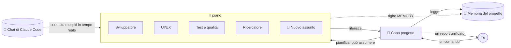

<div align="center">


# Atrium

### Il tuo ufficio di agenti IA. Ogni progetto è un piano, ogni agente ha la sua stanza.

Dai un solo comando a un capo progetto — e guarda un team di agenti Claude raggiungere le proprie scrivanie, lavorare
e tornare con un unico report chiaro. Tutti i tuoi progetti, tutte le tue chat di Claude Code, un solo edificio.

[](https://github.com/RealMrNovember/Atrium/releases/latest)
[](https://github.com/RealMrNovember/Atrium/releases/latest)
[](#-sei-lingue)
[](../../LICENSE)
[](https://github.com/RealMrNovember/Atrium/stargazers)
[](https://buymeacoffee.com/mikeross)

[English](../../README.md) · [Türkçe](README.tr.md) · [Deutsch](README.de.md) · [Français](README.fr.md) · **Italiano** · [Русский](README.ru.md)

[**⬇ Scarica**](https://github.com/RealMrNovember/Atrium/releases/latest) · [**🌐 Showroom**](https://atrium.cicibyte.com) · [**⭐ Metti una stella**](https://github.com/RealMrNovember/Atrium)

<br />


</div>

---

## Perché Atrium?

Se usi Claude Code su tanti progetti, conosci il problema: ogni nuova sessione riparte da zero,
ripeti sempre lo stesso contesto, perdi il filo di quale progetto stia facendo cosa, e il conto cresce
a ogni «rileggo di nuovo tutto il repository».

Atrium trasforma tutto questo in un'azienda che puoi **vedere**:

- 🏢 **I tuoi progetti diventano un edificio.** Punta Atrium alla tua cartella dei progetti; ogni sottocartella diventa un piano.
- 👥 **Ogni piano ha un team.** Un capo progetto, uno sviluppatore, un designer UI/UX, QA, un ricercatore e un custode della memoria — ognuno nella sua stanza, alla sua scrivania.
- 🧭 **Dai un solo comando, il capo guida il team.** Il capo suddivide il lavoro, gli agenti vengono a ritirare i loro compiti, lavorano alle scrivanie e tornano a riferire. Ricevi **un solo** report unificato.
- 🧠 **I progetti ricordano.** Ogni piano mantiene una breve memoria di progetto che ogni agente legge per prima — così nessuno rilegge l'intero codice.
- 🤝 **Non solo Claude.** Ogni agente può funzionare con Claude Code, OpenAI Codex CLI, Gemini CLI, Ollama o qualsiasi server compatibile con OpenAI — anche insieme sullo stesso piano.
- 🦙 **IA locale integrata.** Atrium misura il tuo computer, mostra quali modelli aperti funzioneranno, scarica e installa Ollama e i modelli per te, e qualsiasi agente può usarli — gratis, offline e in privato.
- 💬 **Le tue chat di Claude Code si trasferiscono qui.** Atrium legge le tue conversazioni esistenti di Claude Code e le archivia per progetto. I sub-agenti che Claude avvia in quelle chat compaiono **in tempo reale** come ospiti in una stanza vuota.
- 🛡️ **Resti tu al comando.** Sola lettura per impostazione predefinita, i segreti sono off-limits, limiti di spesa ovunque e nulla viene mai pubblicato o inviato con push. L'ultima parola spetta a te.

## 🪙 Come Atrium risparmia token

Atrium è progettato attorno a un'unica idea: **non pagare due volte lo stesso contesto.**

| Meccanismo | Cosa fa |
|---|---|
| **Memoria di progetto** | Un riassunto Markdown compatto per progetto (cos'è, stack, struttura, come avviarlo, decisioni, lavori recenti, lezioni apprese). Ogni agente lo legge *per primo* e gli viene detto di aprire solo i file che gli servono invece di scansionare il repository. |
| **Memoria che si aggiorna da sola** | Dopo ogni lavoro, il riassunto del capo va in *Lavori recenti* e le righe `MEMORY:` degli agenti in *Appreso*. Il lavoro successivo parte più intelligente — senza riscoprire gli stessi fatti. |
| **Le chat diventano contesto** | Quando si estrae la memoria, vengono inclusi i titoli e le richieste iniziali delle tue vecchie chat di Claude Code per quel progetto — i tuoi obiettivi e le tue decisioni passano avanti senza doverli incollare di nuovo. |
| **Il modello giusto per ogni lavoro** | Il custode della memoria usa Haiku per impostazione predefinita; tu scegli Haiku / Sonnet / Opus per ogni agente. |
| **Pianificazione e unione a basso costo** | Il capo pianifica con strumenti di sola lettura e un budget ridotto, e unisce i report **senza alcuno strumento**. |
| **Compiti mirati** | Ogni agente riceve un compito autosufficiente, non l'intera conversazione. |
| **Limiti rigidi** | Budget per esecuzione, limite di tempo per esecuzione e tetto giornaliero per tutta l'azienda. Se un'esecuzione va in timeout e il suo costo non è leggibile, viene **conteggiato l'intero limite** — il tetto giornaliero non viene mai sottostimato. |
| **Modalità simulazione** | Esplora tutta l'app, le animazioni e i flussi senza spendere un centesimo. |

## Come funziona



1. **Comando.** Apri un piano e di' al capo cosa vuoi. Consenti le modifiche ai file solo se vuoi che vengano fatte.
2. **Piano.** Il capo legge la memoria del progetto, divide il lavoro in al massimo quattro compiti e — se nessuno è adatto — **assume uno specialista** che esce dall'ascensore verso una stanza vuota.
3. **Lavoro.** Gli agenti vanno nell'ufficio del capo a ritirare il loro compito, tornano alla scrivania e lavorano. I loro schermi si accendono e un fumetto mostra cosa stanno facendo in questo momento (`📄 reading cart.ts`, `🔎 searching "calculateTotal"`).
4. **Report.** Ogni agente torna con un report; il capo unisce tutto in *Riepilogo · Fatto · Risultati e rischi · In attesa della tua decisione · Prossimi passi*.
5. **Memoria.** Le lezioni apprese finiscono nella memoria del progetto per la volta successiva.

## 📸 Screenshot

| | |
|---|---|
|  **L'edificio** — ogni progetto è un piano; le finestre illuminate significano che gli agenti stanno lavorando. |  **Memoria del progetto** — il riassunto che ogni agente legge per primo. |
|  **Le tue chat di Claude Code** — archiviate per progetto, con il numero di sub-agenti. |  **Un solo report** — il capo unisce il lavoro del team. |
|  **Configurazione al primo avvio** — sei lingue. |  **Collega Claude** — Atrium verifica per te Claude Code e l'accesso. |

## ⬇ Installazione

Scarica l'installer per il tuo sistema dall'[**ultima release**](https://github.com/RealMrNovember/Atrium/releases/latest):

| Sistema | File |
|---|---|
| Windows 10/11 | `Atrium-Setup-x.y.z.exe` |
| macOS | `Atrium-x.y.z-arm64.dmg` / `-x64.dmg` |
| Linux | `Atrium-x.y.z-x86_64.AppImage` oppure `.deb` |

> Le build per macOS non sono ancora notarizzate: la prima volta fai clic destro sull'app → **Apri**.

### Requisiti

- [Claude Code](https://docs.anthropic.com/en/docs/claude-code) installato (`npm install -g @anthropic-ai/claude-code`) e con accesso effettuato — oppure una chiave API di Anthropic, che Atrium conserva cifrata nel portachiavi del tuo sistema operativo.
- Facoltativo: [OpenAI Codex CLI](https://github.com/openai/codex), [Gemini CLI](https://github.com/google-gemini/gemini-cli), un server compatibile con OpenAI — oppure **nessuna IA cloud**: installa Ollama e i modelli locali dalla pagina **IA locale**.
- Non hai ancora Claude? Attiva la **Simulazione** ed esplora tutto gratuitamente.

### Primo avvio

La procedura guidata ti accompagna in sei passaggi: **lingua → azienda (nome, slogan, logo) → cartella dei progetti → connessione a Claude → le tue chat di Claude Code → limiti di spesa.** Poi il tuo edificio prende forma.

### Compilare dai sorgenti

```bash
git clone https://github.com/RealMrNovember/Atrium.git
cd Atrium
npm install
npm run dev        # run with hot reload
npm run dist       # build an installer for your OS into dist/
```

## 🌍 Sei lingue

English · Türkçe · Deutsch · Français · Italiano · Русский — l'interfaccia **e** i report e la memoria degli agenti seguono la lingua che scegli. Atrium ti propone la lingua del sistema al primo avvio.

## 🛡️ Sicurezza

- Gli agenti **non possono leggere** `.env`, le chiavi private (`*.pem`, `*.key`, `id_rsa*`, `id_ed25519*`) e **non possono eseguire comandi shell**.
- **Sola lettura per impostazione predefinita.** Le modifiche ai file sono consentite comando per comando; in tal caso gli agenti lavorano uno alla volta.
- Gli agenti non fanno mai commit né push, non installano pacchetti, non scrivono a nessuno e non pubblicano nulla.
- Il testo proveniente da pagine web e file è trattato come dato, mai come istruzione.
- Tutto resta sul tuo computer: le chat vengono lette in locale, i dati risiedono nella tua cartella utente.

Consulta [SECURITY.md](../../SECURITY.md) per segnalare una vulnerabilità.

## ❓ FAQ

<details><summary><b>Atrium invia il mio codice o le mie chat da qualche parte?</b></summary>

No. Atrium non ha un proprio server. Gli agenti vengono eseguiti tramite Claude Code sul tuo computer, esattamente come quando usi Claude Code direttamente.
</details>

<details><summary><b>Quanto costa?</b></summary>

Atrium è gratuito. Le esecuzioni degli agenti usano il tuo piano Claude Code o la tua chiave API; Atrium applica un limite per esecuzione e uno giornaliero che scegli tu.
</details>

<details><summary><b>Quali progetti diventano piani?</b></summary>

Ogni sottocartella della cartella che scegli, tranne le cartelle nascoste e quelle che iniziano con `_`.
</details>

<details><summary><b>Posso cambiare il team?</b></summary>

Sì — rinomina gli agenti, modifica le loro descrizioni del ruolo, scegli il loro modello, dai loro accesso al web, spostali da una stanza all'altra oppure clicca su una stanza vuota per assumere. Anche il capo può assumere specialisti in autonomia quando un lavoro lo richiede.
</details>

## 🤝 Contribuire

Segnalazioni di bug, idee, traduzioni e pull request sono molto benvenute — vedi [CONTRIBUTING.md](../../CONTRIBUTING.md).
Atrium è source-available: puoi fare un fork per inviare contributi; ti chiediamo di non pubblicare copie modificate.

## 💜 Supporto

Atrium è gratuito e lo resterà. Se ti fa risparmiare tempo:

- ⭐ **Metti una stella a questo repository** — aiuta davvero.
- 📣 **Condividilo** con un amico o con il tuo team.
- 🐛 **Segnala bug** e proponi funzionalità nelle [Issues](https://github.com/RealMrNovember/Atrium/issues).
- ☕ **Offrimi un caffè** — su [buymeacoffee.com/mikeross](https://buymeacoffee.com/mikeross), per mantenere Atrium gratuito.

## Licenza

Uso gratuito, anche commerciale. Copiare, modificare o ridistribuire richiede un'autorizzazione scritta.
Vedi la [Licenza di Atrium](../../LICENSE).

<div align="center">
<br />
<a href="https://cicibyte.com"><b>CiciByte Technology, Inc.</b></a> · <a href="https://atrium.cicibyte.com">atrium.cicibyte.com</a>
</div>
