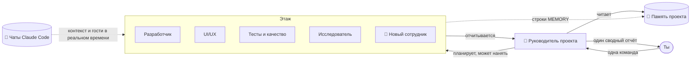

<div align="center">


# Atrium

### Твой офис ИИ-агентов. Каждый проект — этаж, у каждого агента своя комната.

Дай одну команду руководителю проекта — и смотри, как команда агентов Claude идёт к своим столам, работает
и возвращается с одним понятным отчётом. Все твои проекты, все твои чаты Claude Code — в одном здании.

[](https://github.com/RealMrNovember/Atrium/releases/latest)
[](https://github.com/RealMrNovember/Atrium/releases/latest)
[](#-шесть-языков)
[](../../LICENSE)
[](https://github.com/RealMrNovember/Atrium/stargazers)
[](https://buymeacoffee.com/mikeross)

[English](../../README.md) · [Türkçe](README.tr.md) · [Deutsch](README.de.md) · [Français](README.fr.md) · [Italiano](README.it.md) · **Русский**

[**⬇ Скачать**](https://github.com/RealMrNovember/Atrium/releases/latest) · [**🌐 Шоурум**](https://atrium.cicibyte.com) · [**⭐ Поставить звезду**](https://github.com/RealMrNovember/Atrium)

<br />


</div>

---

## Зачем нужен Atrium?

Если ты используешь Claude Code в нескольких проектах, ты знаешь эту боль: каждая новая сессия начинается с нуля,
ты повторяешь один и тот же контекст, теряешь представление о том, что происходит в каждом проекте, а счёт растёт
с каждым «давай-ка я ещё раз прочитаю весь репозиторий».

Atrium превращает всё это в компанию, которую можно **увидеть**:

- 🏢 **Твои проекты становятся зданием.** Укажи Atrium папку с проектами — каждая вложенная папка станет этажом.
- 👥 **У каждого этажа своя команда.** Руководитель проекта, разработчик, UI/UX-дизайнер, QA, исследователь и хранитель памяти — каждый в своей комнате, за своим столом.
- 🧭 **Ты даёшь одну команду, руководитель управляет командой.** Руководитель делит работу, агенты приходят за задачами, работают за своими столами и возвращаются с отчётом. Ты получаешь **один** сводный отчёт.
- 🧠 **Проекты помнят.** Каждый этаж ведёт краткую память проекта, которую каждый агент читает первой, — поэтому никто не перечитывает всю кодовую базу.
- 💬 **Твои чаты Claude Code переезжают сюда.** Atrium читает твои существующие разговоры в Claude Code и раскладывает их по проектам. Суб-агенты, которых Claude запускает в этих чатах, появляются **в реальном времени** как гости в пустой комнате.
- 🛡️ **Контроль остаётся за тобой.** По умолчанию только чтение, секреты под запретом, лимиты расходов везде, и ничего никогда не публикуется и не отправляется push-ем. Последнее слово — за тобой.

## 🪙 Как Atrium экономит токены

Atrium построен вокруг одной идеи: **не плати дважды за один и тот же контекст.**

| Механизм | Что делает |
|---|---|
| **Память проекта** | Компактная Markdown-сводка по каждому проекту (что это, стек, структура, как запускать, решения, недавняя работа, выводы). Каждый агент читает её *первой* и открывает только нужные файлы, а не сканирует весь репозиторий. |
| **Самообновляемая память** | После каждой задачи сводка руководителя попадает в *Недавнюю работу*, а строки агентов `MEMORY:` — в *Выученное*. Следующая задача начинается умнее — без повторного открытия тех же фактов. |
| **Чаты становятся контекстом** | При извлечении памяти в неё включаются заголовки и первые запросы твоих прошлых чатов Claude Code по этому проекту — твои цели и решения переходят дальше без повторной вставки. |
| **Подходящая модель для задачи** | Хранитель памяти по умолчанию работает на Haiku; для каждого агента ты выбираешь Haiku / Sonnet / Opus. |
| **Дешёвое планирование и слияние** | Руководитель планирует с инструментами только для чтения и небольшим бюджетом, а отчёты сводит **вообще без инструментов**. |
| **Сфокусированные задачи** | Каждый агент получает одну самодостаточную задачу, а не весь разговор. |
| **Жёсткие лимиты** | Бюджет на запуск, лимит времени на запуск и дневной лимит на всю компанию. Если запуск превысил время и его стоимость не удаётся определить, засчитывается **весь лимит** — дневной лимит никогда не занижается. |
| **Режим симуляции** | Изучай всё приложение, анимации и сценарии, не потратив ни копейки. |

## Как это работает



1. **Команда.** Открой этаж и скажи руководителю, что тебе нужно. Разрешай изменение файлов, только если хочешь правок.
2. **План.** Руководитель читает память проекта, делит работу максимум на четыре задачи и — если никто не подходит — **нанимает специалиста**, который выходит из лифта в пустую комнату.
3. **Работа.** Агенты идут в кабинет руководителя за задачей, возвращаются к столу и работают. Их экраны загораются, а облачко с текстом показывает, чем они заняты прямо сейчас (`📄 reading cart.ts`, `🔎 searching "calculateTotal"`).
4. **Отчёт.** Каждый агент возвращается с отчётом; руководитель сводит всё в разделы *Итог · Сделано · Находки и риски · Ждёт твоего решения · Следующие шаги*.
5. **Память.** Выводы записываются в память проекта на будущее.

## 📸 Скриншоты

| | |
|---|---|
|  **Здание** — каждый проект — этаж; освещённые окна означают, что агенты работают. |  **Память проекта** — сводка, которую каждый агент читает первой. |
|  **Твои чаты Claude Code** — разложены по проектам, с числом суб-агентов. |  **Один отчёт** — руководитель сводит работу команды. |
|  **Настройка при первом запуске** — шесть языков. |  **Подключение Claude** — Atrium сам проверит Claude Code и вход в аккаунт. |

## ⬇ Установка

Скачай установщик для своей системы со страницы [**последнего релиза**](https://github.com/RealMrNovember/Atrium/releases/latest):

| Система | Файл |
|---|---|
| Windows 10/11 | `Atrium-Setup-x.y.z.exe` |
| macOS | `Atrium-x.y.z-arm64.dmg` / `-x64.dmg` |
| Linux | `Atrium-x.y.z-x86_64.AppImage` или `.deb` |

> Сборки для macOS пока не нотаризованы: в первый раз нажми на приложение правой кнопкой → **Открыть**.

### Требования

- Установленный и авторизованный [Claude Code](https://docs.anthropic.com/en/docs/claude-code) (`npm install -g @anthropic-ai/claude-code`) — либо API-ключ Anthropic, который Atrium хранит в зашифрованном виде в связке ключей твоей ОС.
- Claude ещё нет? Включи **Симуляцию** и изучай всё бесплатно.

### Первый запуск

Мастер настройки проведёт тебя через шесть шагов: **язык → компания (название, слоган, логотип) → папка проектов → подключение Claude → твои чаты Claude Code → лимиты расходов.** После этого твоё здание вырастет.

### Сборка из исходников

```bash
git clone https://github.com/RealMrNovember/Atrium.git
cd Atrium
npm install
npm run dev        # run with hot reload
npm run dist       # build an installer for your OS into dist/
```

## 🌍 Шесть языков

English · Türkçe · Deutsch · Français · Italiano · Русский — интерфейс **и** отчёты с памятью агентов следуют выбранному тобой языку. При первом запуске Atrium предложит язык твоей системы.

## 🛡️ Безопасность

- Агенты **не могут читать** `.env`, приватные ключи (`*.pem`, `*.key`, `id_rsa*`, `id_ed25519*`) и **не могут выполнять команды оболочки**.
- **По умолчанию только чтение.** Изменение файлов разрешается для каждой команды отдельно; тогда агенты работают по одному.
- Агенты никогда не делают commit и push, не устанавливают пакеты, никому не пишут и ничего не публикуют.
- Текст с веб-страниц и из файлов воспринимается как данные, а не как инструкции.
- Всё остаётся на твоём компьютере: чаты читаются локально, данные хранятся в твоей пользовательской папке.

О найденной уязвимости сообщай по инструкции в [SECURITY.md](../../SECURITY.md).

## ❓ FAQ

<details><summary><b>Отправляет ли Atrium мой код или чаты куда-либо?</b></summary>

Нет. У самого Atrium нет сервера. Агенты работают через Claude Code на твоём компьютере — точно так же, как когда ты используешь Claude Code напрямую.
</details>

<details><summary><b>Сколько это стоит?</b></summary>

Atrium бесплатен. Запуски агентов используют твой тариф Claude Code или API-ключ; Atrium применяет выбранные тобой лимиты на запуск и на день.
</details>

<details><summary><b>Какие проекты становятся этажами?</b></summary>

Каждая вложенная папка выбранной тобой папки, кроме скрытых папок и папок, названия которых начинаются с `_`.
</details>

<details><summary><b>Можно ли менять команду?</b></summary>

Да — переименовывай агентов, редактируй их должностные инструкции, выбирай модель, давай доступ в интернет, переноси между комнатами или кликай по пустой комнате, чтобы нанять сотрудника. Руководитель тоже может сам нанимать специалистов, когда задаче это нужно.
</details>

## 🤝 Участие в проекте

Отчёты об ошибках, идеи, переводы и pull request-ы всегда приветствуются — см. [CONTRIBUTING.md](../../CONTRIBUTING.md).
Atrium — проект с открытым исходным кодом для ознакомления (source-available): ты можешь сделать форк, чтобы отправить вклад обратно; пожалуйста, не публикуй изменённые копии.

## 💜 Поддержка

Atrium бесплатен и останется бесплатным. Если он экономит тебе время:

- ⭐ **Поставь звезду этому репозиторию** — это действительно помогает.
- 📣 **Поделись** с другом или командой.
- 🐛 **Сообщай об ошибках** и предлагай функции в [Issues](https://github.com/RealMrNovember/Atrium/issues).
- ☕ **Угости меня кофе** — на [buymeacoffee.com/mikeross](https://buymeacoffee.com/mikeross), чтобы Atrium оставался бесплатным.

## Лицензия

Можно использовать бесплатно, в том числе в коммерческих целях. Копирование, изменение и распространение требуют письменного разрешения.
См. [Лицензию Atrium](../../LICENSE).

<div align="center">
<br />
<a href="https://cicibyte.com"><b>CiciByte Technology, Inc.</b></a> · <a href="https://atrium.cicibyte.com">atrium.cicibyte.com</a>
</div>
