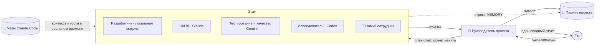

<div align="center">


# Atrium

### Твой офис ИИ-агентов. Каждый проект — этаж, у каждого агента своя комната.

Дай одну команду руководителю проекта — и смотри, как команда ИИ-агентов идёт к своим столам, работает
и возвращается с одним понятным отчётом. Claude, Codex, Gemini или **бесплатные локальные модели** на твоём собственном компьютере —
все твои проекты, все твои чаты Claude Code — в одном здании.

[](https://github.com/RealMrNovember/Atrium/releases/latest)
[](https://github.com/RealMrNovember/Atrium/releases)
[](https://github.com/RealMrNovember/Atrium/releases/latest)
[](#-работает-с-твоим-ии)
[](#-шесть-языков)
[](../../LICENSE)
[](https://github.com/RealMrNovember/Atrium/stargazers)
[](https://buymeacoffee.com/mikeross)

[English](../../README.md) · [Türkçe](README.tr.md) · [Deutsch](README.de.md) · [Français](README.fr.md) · [Italiano](README.it.md) · **Русский**

[**⬇ Скачать**](https://github.com/RealMrNovember/Atrium/releases/latest) · [**🌐 Шоурум**](https://atrium.cicibyte.com) · [**📜 Что нового**](https://github.com/RealMrNovember/Atrium/releases) · [**⭐ Поставить звезду**](https://github.com/RealMrNovember/Atrium)

<br />


</div>

---

## Зачем нужен Atrium?

Если ты используешь ИИ-агентов для программирования в нескольких проектах, ты знаешь эту боль: каждая новая сессия начинается с нуля,
ты повторяешь один и тот же контекст, теряешь представление о том, что происходит в каждом проекте, а счёт растёт
с каждым «давай-ка я ещё раз прочитаю весь репозиторий».

Atrium превращает всё это в компанию, которую можно **увидеть**:

- 🏢 **Твои проекты становятся зданием.** Укажи Atrium папку с проектами — каждая вложенная папка станет этажом.
- 👥 **У каждого этажа своя команда.** Руководитель проекта, разработчик, UI/UX-дизайнер, QA, исследователь и хранитель памяти — каждый в своей комнате, за своим столом.
- 🧭 **Ты даёшь одну команду, руководитель управляет командой.** Руководитель делит работу, агенты приходят за задачами, работают за своими столами и возвращаются с отчётом. Ты получаешь **один** сводный отчёт.
- 🧠 **Проекты помнят.** Каждый этаж ведёт краткую память проекта, которую каждый агент читает первой, — поэтому никто не перечитывает всю кодовую базу.
- 🤝 **Не только Claude.** Каждый агент может работать на Claude Code, OpenAI Codex CLI, Gemini CLI, Ollama или любом OpenAI-совместимом сервере — вперемешку на одном этаже.
- 🦙 **Встроенный локальный ИИ.** Atrium измеряет твой компьютер, показывает, какие открытые модели будут работать, сам скачивает и устанавливает Ollama и модели — и любой агент может ими пользоваться: бесплатно, офлайн и приватно.
- 💬 **Твои чаты Claude Code переезжают сюда.** Atrium читает твои существующие разговоры в Claude Code и раскладывает их по проектам. Открытые чаты зажигают свет на своём этаже, а когда чат ждёт твоего решения, агент высовывается из окна и зовёт тебя.
- 🛡️ **Контроль остаётся за тобой.** По умолчанию только чтение, секреты под запретом, лимиты расходов везде, и ничего никогда не публикуется и не отправляется push-ем. Последнее слово — за тобой.

## 🤖 Работает с твоим ИИ

Выбирай ИИ для каждого агента — руководителем может быть Claude, разработчик при этом работает на локальной модели для кода, а исследователь — на Gemini.

| ИИ-инструмент | Что нужно | Лучше всего для |
|---|---|---|
| ✳️ **Claude Code** | Авторизованный [Claude Code](https://docs.anthropic.com/en/docs/claude-code) или API-ключ Anthropic | Самых сильных агентов; шкала использования тарифа и лимиты в долларах |
| 🌀 **OpenAI Codex CLI** | `npm i -g @openai/codex`, затем **Войти** в Atrium | Агентов на твоём тарифе ChatGPT |
| ♊ **Gemini CLI** | `npm i -g @google/gemini-cli`, вход через Google или API-ключ Gemini | Агентов на твоём Google-аккаунте |
| 🦙 **Ollama** | Ничего — Atrium установит его со страницы **Локальный ИИ** | Бесплатной, офлайн и приватной работы |
| 🔌 **Совместимый с OpenAI** | Адрес сервера (LM Studio, llama.cpp, vLLM, OpenRouter, OpenAI API) | Моделей, которые ты уже где-то запускаешь |

<table><tr>
<td width="50%"></td>
<td width="50%"></td>
</tr><tr>
<td align="center"><b>Одна команда, много ИИ</b> — каждый агент показывает свой инструмент и модель.</td>
<td align="center"><b>Смена в два клика</b> — ИИ-инструмент и модель для каждого агента.</td>
</tr></table>

## 🦙 Локальный ИИ

Запускай агентов на открытых моделях, которые живут на твоём компьютере, — без аккаунта, без подписки, никакие данные не покидают машину.

1. **Измерь.** Atrium считывает процессор, память, видеокарту и свободное место на диске и подсказывает, модели какого размера будут хорошо работать.
2. **Установи движок.** Один клик — и официальный релиз Ollama скачан и установлен, без всякого терминала.
3. **Скачай модель.** Каталог из 37 открытых моделей (общие, для кода, рассуждений, зрения, эмбеддингов и не только), каждая помечена для **твоей** машины как 🟢 *Работает быстро*, 🟡 *Работает медленно* или 🔴 *Слишком большая*, с рекомендацией ⭐.
4. **Попробуй и найми.** Пообщайся с моделью прямо на странице, а затем отдай её любому агенту.

Модели с пометкой **Может быть агентом** открывают и читают файлы проекта через собственные безопасные инструменты Atrium: они не выходят за пределы папки проекта, никогда не открывают секретные файлы и никогда не выполняют команды оболочки.

<table><tr>
<td width="50%"></td>
<td width="50%"></td>
</tr><tr>
<td align="center"><b>Твой компьютер измерен</b> — статус движка и твои модели.</td>
<td align="center"><b>Каталог, который знает твоё железо</b> — загрузка в один клик.</td>
</tr></table>

## 🪙 Как Atrium экономит токены

Atrium построен вокруг одной идеи: **не плати дважды за один и тот же контекст.**

| Механизм | Что делает |
|---|---|
| **Память проекта** | Компактная Markdown-сводка по каждому проекту (что это, стек, структура, как запускать, решения, недавняя работа, выводы). Каждый агент читает её *первой* и открывает только нужные файлы, а не сканирует весь репозиторий. |
| **Самообновляемая память** | После каждой задачи сводка руководителя попадает в *Недавнюю работу*, а строки агентов `MEMORY:` — в *Выученное*. Следующая задача начинается умнее — без повторного открытия тех же фактов. |
| **Рабочие папки** | Каждый агент знает, в каких папках он работает, и начинает с них. |
| **Чаты становятся контекстом** | При извлечении памяти в неё включаются заголовки и первые запросы твоих прошлых чатов Claude Code по этому проекту — твои цели и решения переходят дальше без повторной вставки. |
| **Подходящая модель для задачи** | Haiku для хранителя памяти, Sonnet или Opus там, где это важно, — или бесплатная локальная модель для рутинной работы. |
| **Дешёвое планирование и слияние** | Руководитель планирует с инструментами только для чтения и небольшим бюджетом, а отчёты сводит **вообще без инструментов**. |
| **Жёсткие лимиты** | Бюджет на запуск, лимит времени на запуск и дневной лимит на всю компанию. Если запуск превысил время и его стоимость не удаётся определить, засчитывается **весь лимит** — дневной лимит никогда не занижается. |
| **Режим симуляции** | Изучай всё приложение, анимации и сценарии, не потратив ни копейки. |

## Как это работает



1. **Команда.** Открой этаж и скажи руководителю, что тебе нужно. Разрешай изменение файлов, только если хочешь правок. Или нажми **Обход со статусом** — и руководитель пройдёт от стола к столу, собирая отчёты.
2. **План.** Руководитель читает память проекта, делит работу максимум на четыре задачи и — если никто не подходит — **нанимает специалиста**, который выходит из лифта в пустую комнату.
3. **Работа.** Агенты идут в кабинет руководителя за задачей, возвращаются к столу и работают. Их экраны загораются, а облачко с текстом показывает, чем они заняты прямо сейчас (`📄 reading cart.ts`, `🔎 searching "calculateTotal"`).
4. **Отчёт.** Каждый агент возвращается с отчётом; руководитель сводит всё в разделы *Итог · Сделано · Находки и риски · Ждёт твоего решения · Следующие шаги*.
5. **Память.** Выводы записываются в память проекта на будущее.

## 📸 Больше скриншотов

| | |
|---|---|
|  **Здание** — каждый проект — этаж; яркие окна означают работу, тёплые — открытый чат. |  **Память проекта** — сводка, которую каждый агент читает первой. |
|  **Твои чаты Claude Code** — разложены по проектам, продолжай их прямо в Atrium. |  **Один отчёт** — руководитель сводит работу команды. |
|  **Настройка при первом запуске** — шесть языков. |  **Подключение Claude** — Atrium сам проверит Claude Code и вход в аккаунт. |

## ✨ А ещё внутри

- 📊 **Шкала использования тарифа** — лимиты сессии и недели Claude, в реальном времени на верхней панели.
- 🔔 **Этаж, который тебя зовёт** — когда чат Claude Code ждёт твоего решения, агент машет тебе из окна этого этажа.
- 🎁 **Что нового** — заметки к релизам на твоём языке, показываются ещё до загрузки обновления; полная история версий — в настройках.
- 🔄 **Автоматические обновления** — Atrium проверяет их при запуске и каждые несколько минут, скачивает в фоне и устанавливает при перезапуске.
- 🔊 **Звуковые эффекты** и **встроенное руководство** на шести языках.

## ⬇ Установка

Скачай установщик для своей системы из [**последнего релиза**](https://github.com/RealMrNovember/Atrium/releases/latest):

| Система | Файл |
|---|---|
| Windows 10/11 | `Atrium-Setup-x.y.z.exe` |
| macOS | `Atrium-x.y.z-arm64.dmg` / `-x64.dmg` |
| Linux | `Atrium-x.y.z-x86_64.AppImage` или `.deb` |

> Сборки для macOS пока не нотаризованы: в первый раз нажми на приложение правой кнопкой → **Открыть**.

### Требования

Хотя бы **один** ИИ-инструмент — достаточно любого из этих:

- Авторизованный [Claude Code](https://docs.anthropic.com/en/docs/claude-code) (`npm install -g @anthropic-ai/claude-code`) или API-ключ Anthropic (хранится в зашифрованном виде в связке ключей твоей ОС);
- [OpenAI Codex CLI](https://github.com/openai/codex) или [Gemini CLI](https://github.com/google-gemini/gemini-cli);
- OpenAI-совместимый сервер;
- или **вообще без облачного ИИ** — установи Ollama и локальные модели на странице **Локальный ИИ**.

Просто интересно? Включи **Симуляцию** и изучай всё бесплатно.

### Первый запуск

Мастер настройки проведёт тебя через шесть шагов: **язык → компания (название, слоган, логотип) → папка проектов → подключение Claude → твои чаты Claude Code → лимиты расходов.** После этого твоё здание вырастет. Другие ИИ-инструменты подключаются в разделе **Профиль и настройки → ИИ-инструменты**.

### Сборка из исходников

```bash
git clone https://github.com/RealMrNovember/Atrium.git
cd Atrium
npm install
npm run dev        # run with hot reload
npm run dist       # build an installer for your OS into dist/
```

## 🌍 Шесть языков

English · Türkçe · Deutsch · Français · Italiano · Русский — интерфейс, встроенное руководство, заметки к релизам **и** отчёты с памятью агентов следуют выбранному тобой языку. При первом запуске Atrium предложит язык твоей системы.

## 🛡️ Безопасность

- Агенты **не могут читать** `.env`, приватные ключи (`*.pem`, `*.key`, `id_rsa*`, `id_ed25519*`) и другие секретные файлы.
- Агенты Claude и локальные модели **не могут выполнять команды оболочки**; Codex и Gemini работают в собственной песочнице и получают те же правила.
- **По умолчанию только чтение.** Изменение файлов разрешается для каждой команды отдельно.
- Агенты никогда не делают commit и push, не устанавливают пакеты, никому не пишут и ничего не публикуют.
- Текст с веб-страниц и из файлов воспринимается как данные, а не как инструкции.
- Твой код, чаты и память остаются на твоём компьютере.

О найденной уязвимости сообщай по инструкции в [SECURITY.md](../../SECURITY.md).

## ❓ FAQ

<details><summary><b>Отправляет ли Atrium мой код или чаты куда-либо?</b></summary>

Нет. Твой код, чаты и память проектов остаются на твоём компьютере. Агенты работают через выбранный тобой ИИ-инструмент (Claude Code, Codex, Gemini — или локальную модель, с которой ничего не покидает машину). Сам Atrium обращается только к GitHub и atrium.cicibyte.com за обновлениями и заметками к релизам.
</details>

<details><summary><b>Можно ли пользоваться Atrium без Claude?</b></summary>

Да. Любой агент может работать на OpenAI Codex CLI, Gemini CLI, OpenAI-совместимом сервере или локальной модели через Ollama. Atrium может сам установить Ollama и модели.
</details>

<details><summary><b>Нужен ли мощный компьютер для локального ИИ?</b></summary>

Нет. Небольшие модели (1–4B) работают почти на любом современном компьютере, даже без видеокарты. Страница **Локальный ИИ** измерит твою машину и точно покажет, какие модели работают быстро, медленно или не работают вовсе, — и порекомендует одну из них.
</details>

<details><summary><b>Сколько это стоит?</b></summary>

Atrium бесплатен. Запуски агентов используют твой собственный тариф Claude, ChatGPT или Google либо API-ключ — а с локальными моделями ничего не стоят. Для Claude Atrium применяет выбранные тобой лимиты на запуск и на день.
</details>

<details><summary><b>Какие проекты становятся этажами?</b></summary>

Каждая вложенная папка выбранной тобой папки, кроме скрытых папок и папок, названия которых начинаются с `_`. Можно исключать проекты, добавлять проекты из других папок и менять порядок этажей.
</details>

<details><summary><b>Можно ли менять команду?</b></summary>

Да — переименовывай агентов, редактируй их должностные инструкции, выбирай ИИ-инструмент и модель, давай доступ в интернет, переноси между комнатами или кликай по пустой комнате, чтобы нанять сотрудника. Руководитель тоже может сам нанимать специалистов, когда задаче это нужно.
</details>

## 🤝 Участие в проекте

Отчёты об ошибках, идеи, переводы и pull request-ы всегда приветствуются — см. [CONTRIBUTING.md](../../CONTRIBUTING.md).
Atrium — проект с открытым исходным кодом для ознакомления (source-available): ты можешь сделать форк, чтобы отправить вклад обратно; пожалуйста, не публикуй изменённые копии.

## 💜 Поддержка

Если Atrium экономит тебе время:

- ⭐ **Поставь звезду этому репозиторию** — это действительно помогает.
- 📣 **Поделись** с другом или командой.
- 🐛 **Сообщай об ошибках** и предлагай функции в [Issues](https://github.com/RealMrNovember/Atrium/issues).
- ☕ **Угости меня кофе** — [buymeacoffee.com/mikeross](https://buymeacoffee.com/mikeross).

## Лицензия

Можно использовать бесплатно, в том числе в коммерческих целях. Копирование, изменение и распространение требуют письменного разрешения.
См. [Лицензию Atrium](../../LICENSE).

<div align="center">
<br />
<a href="https://cicibyte.com"><b>CiciByte Technology, Inc.</b></a> · <a href="https://atrium.cicibyte.com">atrium.cicibyte.com</a>
</div>
