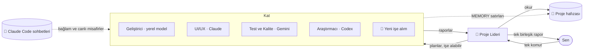

<div align="center">


# Atrium

### Yapay zekâ ajan ofisin. Her proje bir kat, her ajanın kendi odası var.

Proje liderine tek bir komut ver — bir yapay zekâ ajan ekibinin masalarına yürüdüğünü, çalıştığını
ve tek, net bir raporla döndüğünü izle. Claude, Codex, Gemini ya da kendi bilgisayarında **ücretsiz yerel modeller** —
tüm projelerin, tüm Claude Code sohbetlerin, tek bir binada.

[](https://github.com/RealMrNovember/Atrium/releases/latest)
[](https://github.com/RealMrNovember/Atrium/releases)
[](https://github.com/RealMrNovember/Atrium/releases/latest)
[](#-senin-yapay-zekânla-çalışır)
[](#-gizlilik)
[](#-altı-dil)
[](../../LICENSE)
[](https://github.com/RealMrNovember/Atrium/stargazers)
[](https://buymeacoffee.com/mikeross)

[English](../../README.md) · **Türkçe** · [Deutsch](README.de.md) · [Français](README.fr.md) · [Italiano](README.it.md) · [Русский](README.ru.md)

[**⬇ İndir**](https://github.com/RealMrNovember/Atrium/releases/latest) · [**🌐 Vitrin**](https://atrium.cicibyte.com) · [**📜 Yenilikler**](https://github.com/RealMrNovember/Atrium/releases) · [**⭐ Yıldızla**](https://github.com/RealMrNovember/Atrium)

<br />


</div>

---

## Neden Atrium?

Yapay zekâ kodlama ajanlarını birçok projede kullanıyorsan derdi bilirsin: her yeni oturum sıfırdan başlar,
aynı bağlamı tekrar tekrar anlatırsın, hangi projede neler olduğunu kaybedersin ve fatura
her "şu repoyu baştan bir okuyayım" ile büyür.

Atrium bunu **görebildiğin** bir şirkete dönüştürür:

- 🏢 **Projelerin bir binaya dönüşür.** Atrium'u proje klasörüne yönlendir; her alt klasör bir kat olur.
- 👥 **Her katın bir ekibi var.** Bir proje lideri, bir geliştirici, bir UI/UX tasarımcısı, QA, bir araştırmacı ve bir hafıza koruyucusu — her biri kendi odasında, kendi masasında.
- 🧭 **Tek komut verirsin, lider ekibi yönetir.** Lider işi böler, ajanlar görevlerini almaya gelir, masalarında çalışır ve rapor vermek için geri yürür. Sana **tek** bir birleşik rapor gelir.
- 🧠 **Projeler hatırlar.** Her kat, her ajanın önce okuduğu kısa bir proje hafızası tutar — böylece kimse tüm kod tabanını yeniden okumaz.
- 🤝 **Yalnız Claude değil.** Her ajan Claude Code, OpenAI Codex CLI, Gemini CLI, Ollama ya da OpenAI uyumlu herhangi bir sunucuyla çalışabilir — aynı katta karışık.
- 🦙 **Yerleşik yerel YZ.** Atrium bilgisayarını ölçer, hangi açık modellerin çalışacağını gösterir, Ollama'yı ve modelleri senin için indirip kurar ve her ajanın kullanmasını sağlar — ücretsiz, internetsiz ve gizli.
- 💬 **Claude Code sohbetlerin de taşınır.** Atrium mevcut Claude Code konuşmalarını okur ve projeye göre dosyalar. Açık sohbetler katlarını aydınlatır; bir sohbet senin kararını beklediğinde bir ajan pencereden sarkıp sana seslenir.
- 🏙️ **Birçok şirket, tek uygulama.** Stüdyonu ve müşterilerini yan yana yönet — her şirketin kendi projeleri, ekibi, hafızası ve yapay zekâsı olur.
- 🔒 **Tasarımdan gizli.** Kodun, sohbetlerin, hafızan ve anahtarların bilgisayarından hiç çıkmaz. Onları göremeyiz — bize hiç ulaşmazlar.
- 🛟 **Destek içinde.** Uygulamadan dilek, istek, şikayet ya da hata raporu gönder ve cevabı orada oku.
- 🛡️ **Kontrol sende kalır.** Varsayılan olarak salt okunur, gizli bilgiler erişime kapalı, her yerde harcama limitleri var ve hiçbir şey yayımlanmaz ya da push'lanmaz. Son karar senin.

## 🤖 Senin yapay zekânla çalışır

Yapay zekâyı ajan ajan seç — liderin Claude olabilirken geliştirici yerel bir kodlama modeliyle, araştırmacı ise Gemini ile çalışabilir.

| Yapay zekâ aracı | Ne gerekir | En uygun olduğu iş |
|---|---|---|
| ✳️ **Claude Code** | Oturum açılmış [Claude Code](https://docs.anthropic.com/en/docs/claude-code) ya da bir Anthropic API anahtarı | En güçlü ajanlar; plan kullanım göstergesi ve dolar limitleri |
| 🌀 **OpenAI Codex CLI** | `npm i -g @openai/codex`, ardından Atrium'da **Giriş yap** | ChatGPT planınla çalışan ajanlar |
| ♊ **Gemini CLI** | `npm i -g @google/gemini-cli`, Google ile giriş ya da bir Gemini API anahtarı | Google hesabınla çalışan ajanlar |
| 🦙 **Ollama** | Hiçbir şey — Atrium onu **Yerel YZ** sayfasından kurar | Ücretsiz, internetsiz, gizli çalışma |
| 🔌 **OpenAI uyumlu** | Bir adres (LM Studio, llama.cpp, vLLM, OpenRouter, OpenAI API) | Zaten barındırdığın modeller |

<table><tr>
<td width="50%"></td>
<td width="50%"></td>
</tr><tr>
<td align="center"><b>Tek ekip, birçok yapay zekâ</b> — her ajan kendi aracını ve modelini gösterir.</td>
<td align="center"><b>İki tıkla değiştir</b> — ajan başına yapay zekâ aracı ve model.</td>
</tr></table>

## 🦙 Yerel YZ

Ajanları kendi bilgisayarında yaşayan açık modellerle çalıştır — hesap yok, abonelik yok, makineden dışarı veri çıkmaz.

1. **Ölç.** Atrium işlemcini, belleğini, ekran kartını ve boş diskini okur; hangi model boyutlarının iyi çalışacağını söyler.
2. **Motoru kur.** Tek tık resmi Ollama sürümünü indirir ve kurar — terminale gerek yok.
3. **Bir model indir.** 37 açık modellik bir katalog (genel, kodlama, akıl yürütme, görsel, embedding ve daha fazlası); her biri **senin** makinen için 🟢 *Hızlı çalışır*, 🟡 *Yavaş çalışır* ya da 🔴 *Sığmaz* olarak işaretli, ⭐ öneriyle birlikte.
4. **Dene ve işe al.** Modelle doğrudan sayfada sohbet et, sonra onu herhangi bir ajana ver.

**Ajan olabilir** olarak işaretli modeller proje dosyalarını Atrium'un kendi güvenli araçlarıyla açar ve okur: proje klasörünün içinde kalırlar, gizli dosyaları asla açmazlar ve asla kabuk komutu çalıştırmazlar.

<table><tr>
<td width="50%"></td>
<td width="50%"></td>
</tr><tr>
<td align="center"><b>Bilgisayarın ölçüldü</b> — motor durumu ve modellerin.</td>
<td align="center"><b>Donanımını tanıyan bir katalog</b> — tek tıkla indirme.</td>
</tr></table>

## 🔒 Gizlilik

Atrium, **işinin bize hiç ulaşmayacağı** şekilde tasarlandı.

| | Ne | Nereye gider |
|---|---|---|
| 🚫 **Asla** | Projelerin, kodun, dosyaların, sohbetlerin, proje hafızan, komutların, ajan sonuçların, API anahtarların | Bilgisayarında kalır. Yapay zekâ istekleri doğrudan seçtiğin araca gider — yerel modellerde hiçbir yere gitmez. |
| ✋ **Yalnızca sen seçersen** | Ücretsiz bir hesap (e-posta, ad, uygulama sürümü — şifre yalnızca geri çevrilemez bir özet olarak), yazıp gönderdiğin mesajlar ve hata raporları | Atrium'un destek sunucusu. Tanılama bilgisi yalnız kutuyu işaretlersen eklenir ve ne gönderildiğini birebir görürsün. |
| 🔄 **Güncelleme kontrolü** | Uygulama sürümü | Güncellemeleri sunmak ve sürüm notlarını göstermek için GitHub ve atrium.cicibyte.com. |

Hesabını istediğin an silebilirsin — hesabın ve tüm mesajların kalıcı olarak silinir.

## 🪙 Atrium token'dan nasıl tasarruf eder?

Atrium tek bir fikir etrafında tasarlandı: **aynı bağlam için iki kez ödeme yapma.**

| Mekanizma | Ne yapar |
|---|---|
| **Proje hafızası** | Proje başına kompakt bir Markdown özeti (ne olduğu, teknoloji yığını, yapı, nasıl çalıştırılır, kararlar, son işler, çıkarılan dersler). Her ajan *önce* bunu okur ve repoyu taramak yerine yalnızca ihtiyaç duyduğu dosyaları açması söylenir. |
| **Kendini güncelleyen hafıza** | Her işten sonra liderin özeti *Son işler*'e, ajanların `MEMORY:` satırları ise *Öğrenilenler*'e gider. Sonraki iş, aynı bilgileri yeniden keşfetmeden daha akıllı başlar. |
| **Odak klasörleri** | Her ajan hangi klasörlerde çalıştığını bilir ve işe oradan başlar. |
| **Sohbetler bağlama dönüşür** | Hafıza çıkarılırken, o proje için geçmiş Claude Code sohbetlerinin başlıkları ve açılış istekleri dahil edilir — hedeflerin ve kararların yeniden yapıştırmana gerek kalmadan taşınır. |
| **İşe uygun model** | Hafıza koruyucusu için Haiku, önemli olduğu yerde Sonnet ya da Opus — ya da rutin işler için ücretsiz bir yerel model. |
| **Ucuz planlama, ucuz birleştirme** | Lider salt okunur araçlar ve küçük bir bütçeyle planlar, raporları **hiçbir araç kullanmadan** birleştirir. |
| **Katı limitler** | Çalıştırma başına bütçe, çalıştırma başına süre sınırı ve şirket genelinde günlük limit. Bir çalıştırma zaman aşımına uğrar ve maliyeti okunamazsa **limitin tamamı sayılır** — günlük limit hiçbir zaman eksik hesaplanmaz. |
| **Simülasyon modu** | Uygulamanın tamamını, animasyonları ve akışları tek kuruş harcamadan keşfet. |

## Nasıl çalışır?



1. **Komut.** Bir kat aç ve lidere ne istediğini söyle. Dosya değişikliklerine yalnızca düzenleme istiyorsan izin ver. Ya da **Durum turu**'na tıkla; lider masa masa dolaşıp raporları toplasın.
2. **Plan.** Lider proje hafızasını okur, işi en fazla dört göreve böler ve — kimse uygun değilse — asansörden boş bir odaya yürüyen bir **uzman işe alır**.
3. **Çalışma.** Ajanlar görevlerini almak için liderin ofisine yürür, masalarına dönüp çalışır. Ekranları yanar ve bir konuşma balonu o an ne yaptıklarını gösterir (`📄 reading cart.ts`, `🔎 searching "calculateTotal"`).
4. **Rapor.** Her ajan bir raporla geri yürür; lider her şeyi *Özet · Yapılanlar · Bulgular ve riskler · Kararını bekleyenler · Sonraki adımlar* başlıklarında birleştirir.
5. **Hatırlama.** Çıkarılan dersler bir sonraki sefer için proje hafızasına yazılır.

## 📸 Daha fazla ekran görüntüsü

| | |
|---|---|
|  **Bina** — her proje bir kat; parlak pencereler çalışma, sıcak renkli olanlar açık bir sohbet demek. |  **Proje hafızası** — her ajanın önce okuduğu özet. |
|  **Claude Code sohbetlerin** — projeye göre dosyalanmış; onlara doğrudan Atrium'da devam et. |  **Tek rapor** — lider ekibin çalışmasını birleştirir. |
|  **İlk çalıştırma kurulumu** — altı dil. |  **Claude'u bağla** — Atrium, Claude Code'u ve oturum açmayı senin için kontrol eder. |

## 🏙️ Şirketler, projeler ve sohbetler

- **Birçok şirket.** Şirket adının yanındaki ▾ menüsü şirket değiştirir ya da yenisini ekler. Her şirket kendi projelerini, ekibini, hafızasını, raporlarını ve varsayılan yapay zekâ aracını tutar — bir şirket Claude'la, bir diğeri yerel modellerle çalışabilir.
- **Sıfırdan başla.** Henüz proje yok mu? İlk projeni doğrudan kurulum sihirbazında ya da *Katlar* yanındaki **＋** ile oluştur.
- **Yeni sohbetler.** Herhangi bir projede *Sohbetler* sekmesinden yeni bir Claude Code sohbeti başlat; kaydedilir ve her yerden devam ettirilebilir.
- **Dosya ekle.** Görsel, PDF ya da metin dosyalarını komut kutusuna bırak — ekip onları komutla birlikte alır.

<table><tr>
<td width="50%"></td>
<td width="50%"></td>
</tr><tr>
<td align="center"><b>Birçok şirket</b> — her birinin kendi ekibi ve yapay zekâsı.</td>
<td align="center"><b>Yerleşik destek</b> — ve okuyabileceğin bir gizlilik sözü.</td>
</tr></table>

## ✨ İçinde başka neler var?

- 📊 **Her yapay zekâ aracı için bir kullanım kartı** — Claude oturum ve haftalık limitleri, Codex limitleri, diğerleri için bugünkü koşular ve token'lar, Ollama için *yerel · ücretsiz*.
- ⚡ **Tek tıkla bağlan** — *ChatGPT ile bağlan*, *Google ile bağlan* ve *Claude’u bağla* gerekirse aracı kurar ve giriş sayfasını açar.
- 🔔 **Sana seslenen bir kat** — bir Claude Code sohbeti kararını beklediğinde, o katın penceresinden bir ajan el sallar.
- 🎁 **Yenilikler** — sürüm notları senin dilinde, güncelleme daha inmeden gösterilir; tüm sürüm geçmişi Ayarlar'da.
- 🔄 **Otomatik güncellemeler** — Atrium açılışta ve birkaç dakikada bir kontrol eder, arka planda indirir ve yeniden başlatınca kurar.
- 🔊 Altı dilde **ses efektleri** ve **uygulama içi rehber**.

## ⬇ Kurulum

[**Son sürüm**](https://github.com/RealMrNovember/Atrium/releases/latest) sayfasından sistemin için kurulum dosyasını indir:

| Sistem | Dosya |
|---|---|
| Windows 10/11 | `Atrium-Setup-x.y.z.exe` |
| macOS | `Atrium-x.y.z-arm64.dmg` / `-x64.dmg` |
| Linux | `Atrium-x.y.z-x86_64.AppImage` veya `.deb` |

> macOS sürümleri henüz noter onaylı (notarized) değil: ilk seferde uygulamaya sağ tıkla → **Aç**.

### Gereksinimler

En az **bir** yapay zekâ aracı — bunlardan herhangi biri yeterli:

- Oturum açılmış [Claude Code](https://docs.anthropic.com/en/docs/claude-code) (`npm install -g @anthropic-ai/claude-code`) ya da bir Anthropic API anahtarı (işletim sistemi anahtar zincirinle şifreli olarak saklanır);
- [OpenAI Codex CLI](https://github.com/openai/codex) ya da [Gemini CLI](https://github.com/google-gemini/gemini-cli);
- OpenAI uyumlu bir sunucu;
- ya da **hiç bulut yapay zekâsı olmadan** — Ollama'yı ve yerel modelleri **Yerel YZ** sayfasından kur.

Sadece merak mı ediyorsun? **Simülasyon**'u aç ve her şeyi ücretsiz keşfet.

### İlk çalıştırma

Kurulum sihirbazı seni altı adımda yönlendirir: **dil → şirket (ad, slogan, logo) → projeler (bir klasör seç ya da ilk projeni oluştur) → yapay zeka (Claude, ChatGPT/Codex, Gemini, Ollama — her biri tek tık) → Claude Code sohbetlerin → harcama limitleri.** Ardından binan yükselir.

### Kaynaktan derleme

```bash
git clone https://github.com/RealMrNovember/Atrium.git
cd Atrium
npm install
npm run dev        # run with hot reload
npm run dist       # build an installer for your OS into dist/
```

## 🌍 Altı dil

English · Türkçe · Deutsch · Français · Italiano · Русский — arayüz, uygulama içi rehber, sürüm notları **ve** ajanların raporları ile hafızası seçtiğin dili takip eder. Atrium ilk çalıştırmada sistem dilini önerir.

## 🛡️ Güvenlik

- Ajanlar `.env` dosyalarını, özel anahtarları (`*.pem`, `*.key`, `id_rsa*`, `id_ed25519*`) ve diğer gizli dosyaları **okuyamaz**.
- Claude ajanları ve yerel modeller **kabuk komutu çalıştıramaz**; Codex ve Gemini kendi sanal alanlarında (sandbox) çalışır ve aynı kuralları alır.
- **Varsayılan olarak salt okunur.** Dosya değişikliklerine komut başına izin verilir.
- Ajanlar asla commit atmaz, push'lamaz, paket yüklemez, kimseye mesaj göndermez ve hiçbir şey yayımlamaz.
- Web sayfalarından ve dosyalardan gelen metin veri olarak ele alınır, asla talimat olarak değil.
- Kodun, sohbetlerin ve hafızan bilgisayarında kalır.

Bir güvenlik açığını bildirmek için [SECURITY.md](../../SECURITY.md) dosyasına bak.

## ❓ SSS

<details><summary><b>Atrium kodumu veya sohbetlerimi bir yere gönderiyor mu?</b></summary>

Hayır. Kodun, sohbetlerin ve proje hafızan bilgisayarında kalır. Ajanlar seçtiğin yapay zekâ aracı üzerinden çalışır (Claude Code, Codex, Gemini — ya da makineden hiçbir şeyin çıkmadığı yerel bir model). Atrium'un kendisi yalnızca güncellemeler ve sürüm notları için GitHub'ı ve atrium.cicibyte.com'u kontrol eder — ve yalnızca kullanırsan hesap bilgilerini ve yazdığın mesajları gönderir. Bkz. [Gizlilik](#-gizlilik).
</details>

<details><summary><b>Hesap gerekli mi?</b></summary>

Hayır. Atrium hesap olmadan da tam olarak çalışır. Ücretsiz hesap yalnızca bize geri bildirim ya da hata raporu göndermek ve cevaplarımızı okumak için gerekir — e-posta ya da Google ile kaydolabilir, istediğin an silebilirsin.
</details>

<details><summary><b>Birden fazla şirket yönetebilir miyim?</b></summary>

Evet. İstediğin kadar şirket ekle; her birinin kendi projeleri, ekibi, hafızası, raporları ve varsayılan yapay zekâ aracı olur. Şirket adının yanındaki ▾ menüsünden geçiş yap.
</details>

<details><summary><b>Atrium'u Claude olmadan kullanabilir miyim?</b></summary>

Evet. Her ajan OpenAI Codex CLI, Gemini CLI, OpenAI uyumlu bir sunucu ya da Ollama üzerinden yerel bir modelle çalışabilir. Atrium Ollama'yı ve modelleri senin için kurabilir.
</details>

<details><summary><b>Yerel YZ için güçlü bir bilgisayar gerekir mi?</b></summary>

Hayır. Küçük modeller (1–4B) ekran kartı olmasa bile neredeyse her yeni bilgisayarda çalışır. **Yerel YZ** sayfası makineni ölçer ve hangi modellerin hızlı, yavaş çalışacağını ya da hiç çalışmayacağını tam olarak gösterir — ve bir tane önerir.
</details>

<details><summary><b>Ne kadar tutuyor?</b></summary>

Atrium ücretsizdir. Ajan çalıştırmaları kendi Claude, ChatGPT ya da Google planını veya API anahtarını kullanır — yerel modellerle hiçbir şeye mal olmaz. Claude için Atrium, senin belirlediğin çalıştırma başı ve günlük bir limit uygular.
</details>

<details><summary><b>Hangi projeler kat olur?</b></summary>

Seçtiğin klasörün gizli klasörler ve `_` ile başlayanlar dışındaki her alt klasörü. Projeleri hariç tutabilir, başka klasörlerden proje ekleyebilir ve katları yeniden sıralayabilirsin.
</details>

<details><summary><b>Ekibi değiştirebilir miyim?</b></summary>

Evet — ajanları yeniden adlandırabilir, görev tanımlarını düzenleyebilir, yapay zekâ araçlarını ve modellerini seçebilir, web erişimi verebilir, odalar arasında taşıyabilir ya da boş bir odaya tıklayıp işe alım yapabilirsin. Bir iş gerektirdiğinde lider de kendi başına uzman işe alabilir.
</details>

## 🤝 Katkıda bulunma

Hata bildirimleri, fikirler, çeviriler ve pull request'ler çok makbule geçer — bkz. [CONTRIBUTING.md](../../CONTRIBUTING.md).
Atrium kaynağı açık görülebilir (source-available) bir projedir: katkıları geri göndermek için fork'layabilirsin; lütfen değiştirilmiş kopyaları yayımlama.

## 💜 Destek

Atrium sana zaman kazandırıyorsa:

- ⭐ **Bu depoyu yıldızla** — gerçekten çok yardımı olur.
- 📣 Bir arkadaşınla veya ekibinle **paylaş**.
- 🐛 Uygulamanın **🛟 Destek** sayfasından ya da [Issues](https://github.com/RealMrNovember/Atrium/issues) bölümünde **hata bildir** ve özellik öner.
- ☕ **Bir kahve ısmarla** — [buymeacoffee.com/mikeross](https://buymeacoffee.com/mikeross).

## Lisans

Ticari kullanım dahil kullanımı ücretsizdir. Kopyalamak, değiştirmek veya yeniden dağıtmak yazılı izin gerektirir.
Bkz. [Atrium Lisansı](../../LICENSE).

<div align="center">
<br />
<a href="https://cicibyte.com"><b>CiciByte Technology, Inc.</b></a> · <a href="https://atrium.cicibyte.com">atrium.cicibyte.com</a>
</div>
