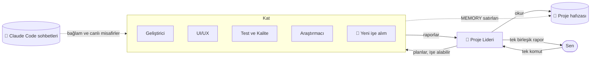

<div align="center">


# Atrium

### Yapay zekâ ajan ofisin. Her proje bir kat, her ajanın kendi odası var.

Proje liderine tek bir komut ver — bir Claude ajan ekibinin masalarına yürüdüğünü, çalıştığını
ve tek, net bir raporla döndüğünü izle. Tüm projelerin, tüm Claude Code sohbetlerin, tek bir binada.

[](https://github.com/RealMrNovember/Atrium/releases/latest)
[](https://github.com/RealMrNovember/Atrium/releases/latest)
[](#-altı-dil)
[](../../LICENSE)
[](https://github.com/RealMrNovember/Atrium/stargazers)

[English](../../README.md) · **Türkçe** · [Deutsch](README.de.md) · [Français](README.fr.md) · [Italiano](README.it.md) · [Русский](README.ru.md)

[**⬇ İndir**](https://github.com/RealMrNovember/Atrium/releases/latest) · [**🌐 Vitrin**](https://atrium.cicibyte.com) · [**⭐ Yıldızla**](https://github.com/RealMrNovember/Atrium)

<br />


</div>

---

## Neden Atrium?

Claude Code'u birçok projede kullanıyorsan derdi bilirsin: her yeni oturum sıfırdan başlar,
aynı bağlamı tekrar tekrar anlatırsın, hangi projede neler olduğunu kaybedersin ve fatura
her "şu repoyu baştan bir okuyayım" ile büyür.

Atrium bunu **görebildiğin** bir şirkete dönüştürür:

- 🏢 **Projelerin bir binaya dönüşür.** Atrium'u proje klasörüne yönlendir; her alt klasör bir kat olur.
- 👥 **Her katın bir ekibi var.** Bir proje lideri, bir geliştirici, bir UI/UX tasarımcısı, QA, bir araştırmacı ve bir hafıza koruyucusu — her biri kendi odasında, kendi masasında.
- 🧭 **Tek komut verirsin, lider ekibi yönetir.** Lider işi böler, ajanlar görevlerini almaya gelir, masalarında çalışır ve rapor vermek için geri yürür. Sana **tek** bir birleşik rapor gelir.
- 🧠 **Projeler hatırlar.** Her kat, her ajanın önce okuduğu kısa bir proje hafızası tutar — böylece kimse tüm kod tabanını yeniden okumaz.
- 💬 **Claude Code sohbetlerin de taşınır.** Atrium mevcut Claude Code konuşmalarını okur ve projeye göre dosyalar. Claude'un bu sohbetlerde başlattığı alt ajanlar boş bir odada misafir olarak **canlı** görünür.
- 🛡️ **Kontrol sende kalır.** Varsayılan olarak salt okunur, gizli bilgiler erişime kapalı, her yerde harcama limitleri var ve hiçbir şey yayımlanmaz ya da push'lanmaz. Son karar senin.

## 🪙 Atrium token'dan nasıl tasarruf eder?

Atrium tek bir fikir etrafında tasarlandı: **aynı bağlam için iki kez ödeme yapma.**

| Mekanizma | Ne yapar |
|---|---|
| **Proje hafızası** | Proje başına kompakt bir Markdown özeti (ne olduğu, teknoloji yığını, yapı, nasıl çalıştırılır, kararlar, son işler, çıkarılan dersler). Her ajan önce bunu okur ve repoyu taramak yerine yalnızca ihtiyaç duyduğu dosyaları açması söylenir. |
| **Kendini güncelleyen hafıza** | Her işten sonra liderin özeti *Son işler*'e, ajanların `MEMORY:` satırları ise *Öğrenilenler*'e gider. Sonraki iş, aynı bilgileri yeniden keşfetmeden daha akıllı başlar. |
| **Sohbetler bağlama dönüşür** | Hafıza çıkarılırken, o proje için geçmiş Claude Code sohbetlerinin başlıkları ve açılış istekleri dahil edilir — hedeflerin ve kararların yeniden yapıştırmana gerek kalmadan taşınır. |
| **İşe uygun model** | Hafıza koruyucusu varsayılan olarak Haiku'da çalışır; ajan başına Haiku / Sonnet / Opus seçimi sende. |
| **Ucuz planlama, ucuz birleştirme** | Lider salt okunur araçlar ve küçük bir bütçeyle planlar, raporları **hiçbir araç kullanmadan** birleştirir. |
| **Odaklı görevler** | Her ajan tüm konuşmayı değil, tek ve kendi içinde eksiksiz bir görevi alır. |
| **Katı limitler** | Çalıştırma başına bütçe, çalıştırma başına süre sınırı ve şirket genelinde günlük limit. Bir çalıştırma zaman aşımına uğrar ve maliyeti okunamazsa **limitin tamamı sayılır** — günlük limit hiçbir zaman eksik hesaplanmaz. |
| **Simülasyon modu** | Uygulamanın tamamını, animasyonları ve akışları tek kuruş harcamadan keşfet. |

## Nasıl çalışır?



1. **Komut.** Bir kat aç ve lidere ne istediğini söyle. Dosya değişikliklerine yalnızca düzenleme istiyorsan izin ver.
2. **Plan.** Lider proje hafızasını okur, işi en fazla dört göreve böler ve — kimse uygun değilse — asansörden boş bir odaya yürüyen bir **uzman işe alır**.
3. **Çalışma.** Ajanlar görevlerini almak için liderin ofisine yürür, masalarına dönüp çalışır. Ekranları yanar ve bir konuşma balonu o an ne yaptıklarını gösterir (`📄 reading cart.ts`, `🔎 searching "calculateTotal"`).
4. **Rapor.** Her ajan bir raporla geri yürür; lider her şeyi *Özet · Yapılanlar · Bulgular ve riskler · Kararını bekleyenler · Sonraki adımlar* başlıklarında birleştirir.
5. **Hatırlama.** Çıkarılan dersler bir sonraki sefer için proje hafızasına yazılır.

## 📸 Ekran görüntüleri

| | |
|---|---|
|  **Bina** — her proje bir kat; yanan pencereler ajanların çalıştığını gösterir. |  **Proje hafızası** — her ajanın önce okuduğu özet. |
|  **Claude Code sohbetlerin** — projeye göre dosyalanmış, alt ajan sayılarıyla. |  **Tek rapor** — lider ekibin çalışmasını birleştirir. |
|  **İlk çalıştırma kurulumu** — altı dil. |  **Claude'u bağla** — Atrium, Claude Code'u ve oturum açmayı senin için kontrol eder. |

## ⬇ Kurulum

[**Son sürüm**](https://github.com/RealMrNovember/Atrium/releases/latest) sayfasından sistemin için kurulum dosyasını indir:

| Sistem | Dosya |
|---|---|
| Windows 10/11 | `Atrium-Setup-x.y.z.exe` |
| macOS | `Atrium-x.y.z-arm64.dmg` / `-x64.dmg` |
| Linux | `Atrium-x.y.z-x86_64.AppImage` veya `.deb` |

> macOS sürümleri henüz noter onaylı (notarized) değil: ilk seferde uygulamaya sağ tıkla → **Aç**.

### Gereksinimler

- [Claude Code](https://docs.anthropic.com/en/docs/claude-code) kurulu (`npm install -g @anthropic-ai/claude-code`) ve oturum açılmış olmalı — ya da Atrium'un işletim sistemi anahtar zincirinle şifreli olarak sakladığı bir Anthropic API anahtarı.
- Henüz Claude yok mu? **Simülasyon**'u aç ve her şeyi ücretsiz keşfet.

### İlk çalıştırma

Kurulum sihirbazı seni altı adımda yönlendirir: **dil → şirket (ad, slogan, logo) → projeler klasörü → Claude bağlantısı → Claude Code sohbetlerin → harcama limitleri.** Ardından binan yükselir.

### Kaynaktan derleme

```bash
git clone https://github.com/RealMrNovember/Atrium.git
cd Atrium
npm install
npm run dev        # run with hot reload
npm run dist       # build an installer for your OS into dist/
```

## 🌍 Altı dil

English · Türkçe · Deutsch · Français · Italiano · Русский — arayüz **ve** ajanların raporları ile hafızası seçtiğin dili takip eder. Atrium ilk çalıştırmada sistem dilini önerir.

## 🛡️ Güvenlik

- Ajanlar `.env` dosyalarını, özel anahtarları (`*.pem`, `*.key`, `id_rsa*`, `id_ed25519*`) **okuyamaz** ve **kabuk komutu çalıştıramaz**.
- **Varsayılan olarak salt okunur.** Dosya değişikliklerine komut başına izin verilir; o durumda ajanlar tek tek çalışır.
- Ajanlar asla commit atmaz, push'lamaz, paket yüklemez, kimseye mesaj göndermez ve hiçbir şey yayımlamaz.
- Web sayfalarından ve dosyalardan gelen metin veri olarak ele alınır, asla talimat olarak değil.
- Her şey bilgisayarında kalır: sohbetler yerel olarak okunur, veriler kullanıcı klasöründe tutulur.

Bir güvenlik açığını bildirmek için [SECURITY.md](../../SECURITY.md) dosyasına bak.

## ❓ SSS

<details><summary><b>Atrium kodumu veya sohbetlerimi bir yere gönderiyor mu?</b></summary>

Hayır. Atrium'un kendi sunucusu yok. Ajanlar, Claude Code'u doğrudan kullandığındaki gibi, makinende Claude Code üzerinden çalışır.
</details>

<details><summary><b>Ne kadar tutuyor?</b></summary>

Atrium ücretsizdir. Ajan çalıştırmaları Claude Code planını veya API anahtarını kullanır; Atrium, senin belirlediğin çalıştırma başı ve günlük bir limit uygular.
</details>

<details><summary><b>Hangi projeler kat olur?</b></summary>

Seçtiğin klasörün gizli klasörler ve `_` ile başlayanlar dışındaki her alt klasörü.
</details>

<details><summary><b>Ekibi değiştirebilir miyim?</b></summary>

Evet — ajanları yeniden adlandırabilir, görev tanımlarını düzenleyebilir, modellerini seçebilir, web erişimi verebilir, odalar arasında taşıyabilir ya da boş bir odaya tıklayıp işe alım yapabilirsin. Bir iş gerektirdiğinde lider de kendi başına uzman işe alabilir.
</details>

## 🤝 Katkıda bulunma

Hata bildirimleri, fikirler, çeviriler ve pull request'ler çok makbule geçer — bkz. [CONTRIBUTING.md](../../CONTRIBUTING.md).
Atrium kaynağı açık görülebilir (source-available) bir projedir: katkıları geri göndermek için fork'layabilirsin; lütfen değiştirilmiş kopyaları yayımlama.

## 💜 Destek

Atrium ücretsizdir ve ücretsiz kalacak. Sana zaman kazandırıyorsa:

- ⭐ **Bu depoyu yıldızla** — gerçekten çok yardımı olur.
- 📣 Bir arkadaşınla veya ekibinle **paylaş**.
- 🐛 [Issues](https://github.com/RealMrNovember/Atrium/issues) bölümünde **hata bildir** ve özellik öner.
- ☕ **Sponsor ol** — bağış bağlantıları [vitrinde](https://atrium.cicibyte.com/#support).

## Lisans

Ticari kullanım dahil kullanımı ücretsizdir. Kopyalamak, değiştirmek veya yeniden dağıtmak yazılı izin gerektirir.
Bkz. [Atrium Lisansı](../../LICENSE).

<div align="center">
<br />
<a href="https://cicibyte.com"><b>CiciByte Technology, Inc.</b></a> · <a href="https://atrium.cicibyte.com">atrium.cicibyte.com</a>
</div>
